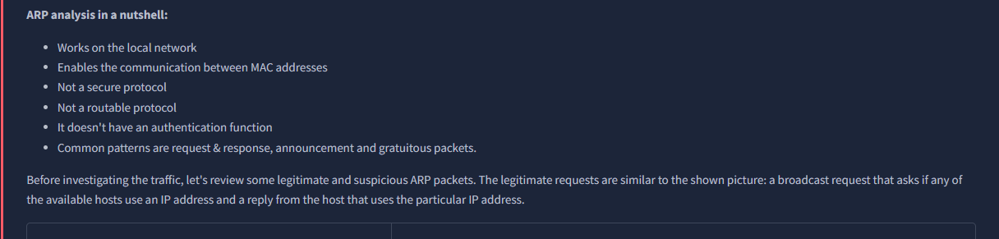
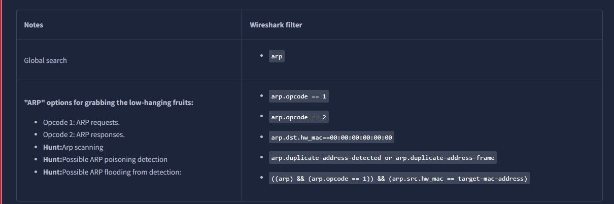
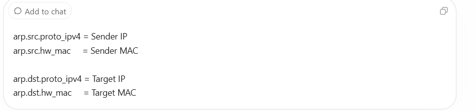
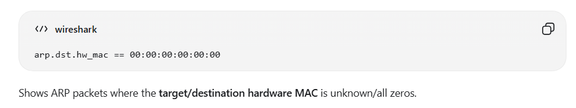
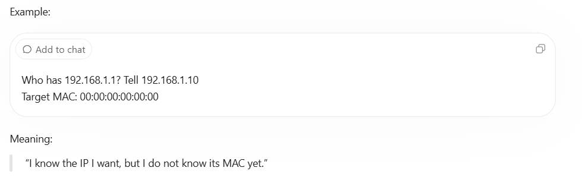
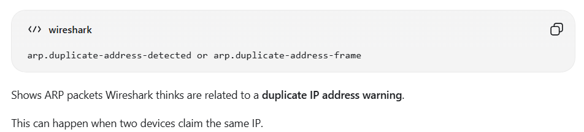
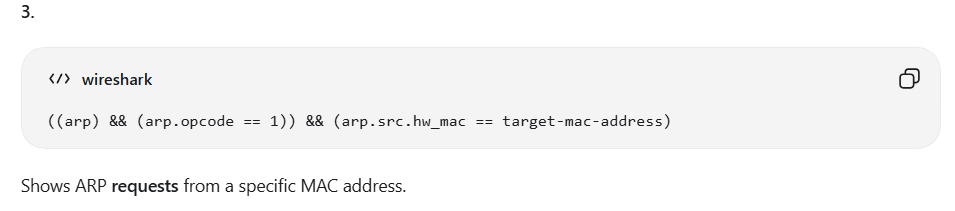
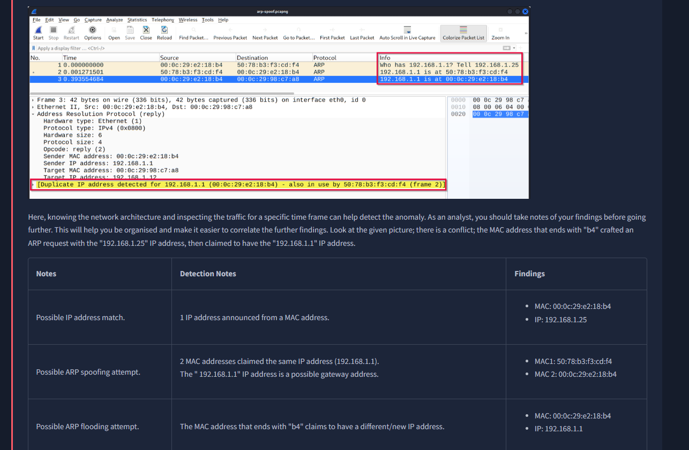
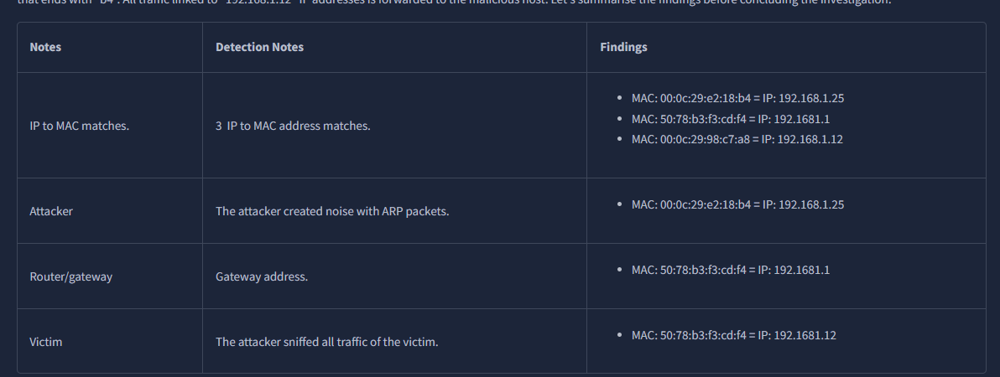

ARP is the mapping between **IP address and MAC address**
ARP does not truly verify that the IP really belongs to that MAC/host.

Usually DHCP snooping and manual ARP mapping is used to combat this attack 


Victim -> Attacker ()-> Gateway -> External Server
External Server -> Gateway -> Attacker -> Victim
```
To victim:
192.168.10.1 is at AA:BB:CC:DD:EE:FF
```
```
To gateway:
192.168.10.2 is at AA:BB:CC:DD:EE:FF
```


Representation of the path of MITM




- **Gratuitous ARP packets** are ARP messages sent **without being asked first**.
	-Gratuitous ARP packets are normal too since they are used to update ARP caches, detect duplicate IP address, announce a new IP/MAC mapping, tells moving of IP/MAC 





arp requests contains





arp
arp.opcode == 1
arp.opcode == 2
arp.dst.hw_mac == 00:00:00:00:00:00 <- this is from a broadcast arp, so usually this contains the "Who has" message since they are looking for the MAC address that is tied to an IP. This is useful for finding out who has been requesting ARP requests. 
arp.src.hw_mac, this can either be for requests or replies, as long as it involves arp, and filters out arp packets came from the specified source address
arp.duplicate-address-detected or arp.duplicate-address-frame (based on wiresharks detection logic)
for responses claiming IPs we instead use, since it's a response we start with 
arp.opcode == 2 and arp.src.proto_ipv4 == [client IP within that local segment]

above are used to identify arp requests 
eth.dst / eth.src == [target MAC]
eth.addr == [target MAC]
http.request.method == "POST"

# filters in initial phase of it







# Filters in suspicious ARP Responses for duplicate IPs 





# Filters in the ARP request and the specific MAC address that you want to see 





- Indicator that someone might be doing an ARP sweep/scan

Both victim and gateway should be captured to capture both sides of the traffic 

Example 1 








**Usually presence of the same MACs from different IPs is a suspicious behavior** 

For this module I learned about how an on-path might be achieved through abusing the ARP response/request. ARP Poisoning works by associating the IP address of a host with the attacker's MAC address. A simple example would be the following, Client A communicating with Client B: 

Network Components: 
Client A: 192.168.10.1
MAC Address: AA:AA:AA:AA:AA:AA

Gateway A: 192.168.10.254
MAC Address: A1:A1:A1:A1:A1:A1

Client B: 192.168.20.1
MAC Address: BB:BB:BB:BB:BB:BB

Gateway B: 192.169.20.254
MAC Address: B1:B1:B1:B1:B1:B1

Attacker's Machine: 192.168.10.2 (Assuming this is a spoofed IP address)
MAC address: CC:CC:CC:CC:CC:CC

A normal flow of traffic w/o MITM would be: 
Client A <-> Gateway A <-> Gateway B <-> Client B 

And the ARP process usually works on the Layer 2 network, which maps a MAC Address to an IP. 
The ARP process works by sending an ARP Request that is broadcasted throughout the network. The packet contains "Who has the MAC address of 192.168.10.2? Send it to 192.168.10.1". This is broadcasted throughout the network, meaning all devices receive this message, once the device with the IP address of 192.168.10.2 receives it. .2 sends its MAC Address to .1 and the ARP Cache is updated. Mapping .2 to its respective MAC Address. 

Now, an attacker can abuse this to create an on-path attack. 

The attacker starts by sweeping or flooding the network with ARP Requests. Probing the different hosts targeted for their MAC address. This can help gather information about the devices that exist within their networks and their respective MAC addresses. 

An attacker can pick one of the clients to attack by now sending gratuitous packets. Let's say the attacker is targeting Client A (assuming he knows the Gateways MAC Address), he sends a gratuitous packet to Client A containing "192.168.10.254 is at CC:CC:CC:CC:CC:CC". This is the attacker poisoning the cache of the Client A by making it seem that the attacker is the gateway. So whenever the traffic goes out of the LAN the attacker can gain access to it since it's sent to him. This is one way, for outbound traffic, for the attacker to be in the path when it receives traffic. It also needs to send a gratuitous ARP request to the gateway, but this time associating the IP of the Client A to the MAC of the attacker. So something like, "192.168.10.1 is at CC:CC:CC:CC:CC:CC". 

In analyzing these packets through Wireshark, we can investigate by looking at ARP flooding. This is a scan of the network. 

For the ARP poisoning, we can look at requests to get the MAC of the gateway, and then we can also need to watch out for duplicate IPs pointing to different MAC addresses via an ARP response. 

After that is sorted out, we can loot at outbound or inbound traffic. Assuming that the victim was using a HTTP application. We can look at the the IP of our client and what it's trying to reach out to. And then using their conversation we can add the MAC address, and identify the IP that the attacker is using, and even the information that he has succeeded in obtaining.

We can filter this out by first isolating the MAC address of the attacker using eth.dest == [attacker's MAC]. Since this MAC is used between the gateway and the attacker. 