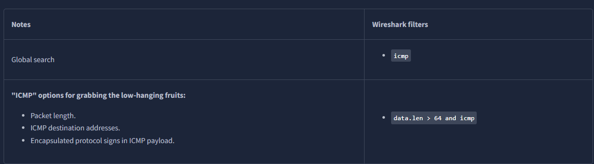
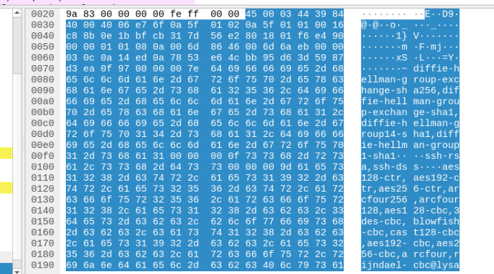
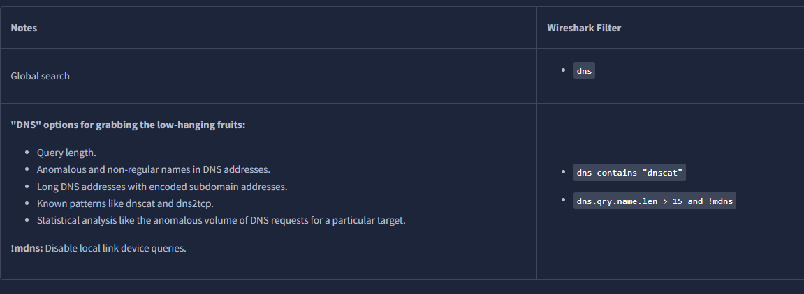

 **transferring the data/resources** in a secure method to network segments and zones. It can be used for "***internet to private networks***" and "***private networks to internet***" flow/direction.

Tunneling - provides anonymity and traffic security. 

# ICMP

**Internet Control Message Protocol (ICMP)** is designed for **diagnosing and reporting** network communication issues

Can be used for:
1. DoS
2. C2 communications 

Can be used after a breach, for data exfiltration or C2 communication. 

So usually, ICMP packets are 64 bytes in size
- Doesn't mean that attacker can't craft ICMP packets that are 64 bytes in size
- But it is important to know that they are usually 64 bytes in size








# DNS 

The phonebook of the internet. Maps names to IP 
Can also be used for: 
1. C2 communications 
2. Data Exfiltration 

Usually: 
1. Attacker owns a DNS server 
2. Owns a domain name where
	1. DNS traffic is requested and sent to 

So the structure of it is usually:  
	**"encoded-commands.maliciousdomain.com"**

Usually, it carries outbound data. 





```
dns.qry.name.len > 15
```

That just means “show longer DNS query names.” THM adds `!mdns` to remove local multicast DNS noise.

```
dnscat / dnscat2
```

A DNS tunnelling tool often used for C2-like communication over DNS. It can create an encrypted command channel using DNS queries/responses.

```
dns2tcp
```

A tool that tunnels TCP connections over DNS. For example, carrying a TCP-like session through DNS queries/responses when normal TCP is blocked.

```
dns.qry.name.len > 15 && !mdns
```

***Show DNS queries with long query names, excluding multicast DNS.***

```
k39s8dla.analytics-update.com
83hdk20a.analytics-update.com
chunk001.analytics-update.com
```

So the string `dnscat` may disappear from the DNS names, but the **behavior** can still remain:

