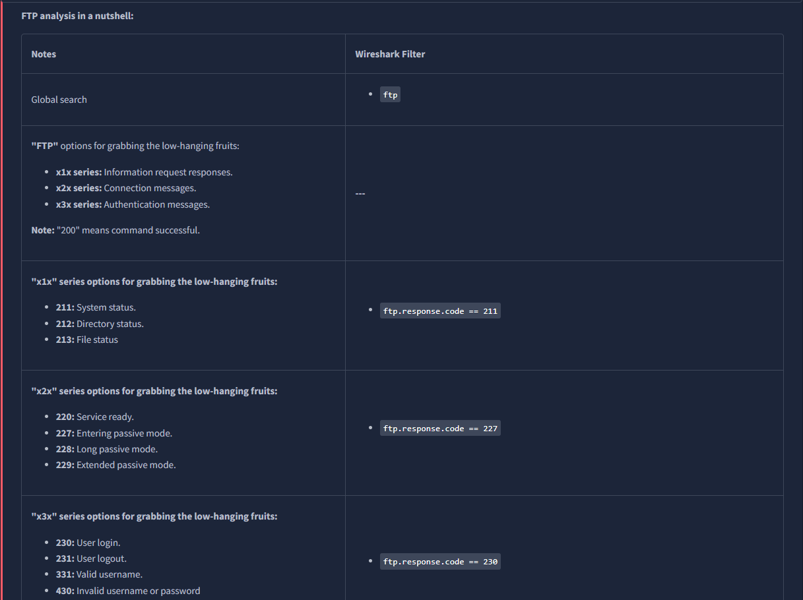
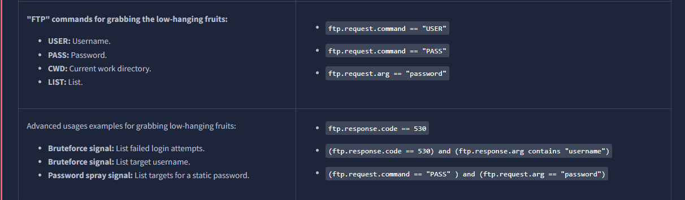

Proper analysis is more than following the stream of data

We need to create statistics and not just follow data 

FTP in an unsecured environment can be abused for: 
- MITM attacks
- Credential stealing and unauthorized access
- Phishing
- Malware planting
- Data exfiltration





arg is value passed with the command 

**1xx series**  
These are usually informational/preliminary, but the ones shown here are status/info responses.

```
211 = System status
```

Server is reporting general system/server status.

```
212 = Directory status
```

Server is reporting directory-related status.

```
213 = File status
```

Server is reporting file-related status, often size/date/status info.

Useful when investigating:

```
What file or directory information did the client request?
```


**2xx series**  
These usually mean success or accepted action.

```
220 = Service ready
```

FTP server is ready. Often appears as the server banner when the connection starts.

```
227 = Entering passive mode
```

Server tells the client what IP/port to connect to for the FTP data channel.

```
228 = Long passive mode
```

Similar passive-mode setup, extended format

```
229 = Extended passive mode
```

Extended passive mode, often used with modern FTP/IP versions. Also tells the client where to open the data connection.

Useful when investigating:

```
Was FTP available?
Did the server accept commands?
What data connection port was negotiated?
```


**3xx series**  
These usually mean the command was accepted, but the server needs more information.

```
230 = User login
```

Login successful.

```
231 = User logout
```

User logged out / session ended.

```
331 = Valid username
```

Username is accepted, but password is required.

```
430 = Invalid username or password
```

Login failed due to invalid credentials.

Useful when investigating:

```
Was login successful?
Which username was tried?
Was there brute force?
Were credentials sent in cleartext?
```





```
ftp.request.command == "USER" && ftp.request.arg == "bob"
```

shows users that entered in the value bob

arg is a value 

`530` usually means:

```
Not logged in / login incorrect
```

^^^ 
LOGIN FAILURES 

```
(ftp.response.code == 530) && (ftp.response.arg contains "username")
```
^^^^^^
Meaning:

```
Show failed login responses where the server message contains a specific username/word.
```


```
(ftp.request.command == "PASS") && (ftp.request.arg == "password")
```

Meaning:

```
Show FTP password submissions where the password equals "password".
```

^^^
Useful for finding spraying because you are looking for password submissions with the same value 

**FOLLOW STREAM** TO SEE WHAT THE USER IS DOING 