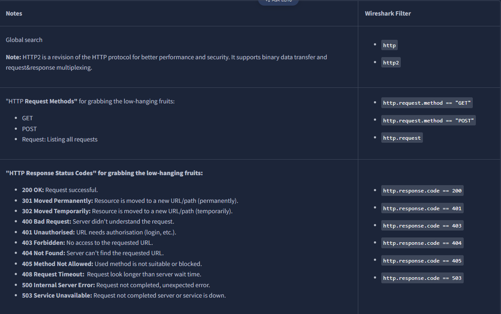
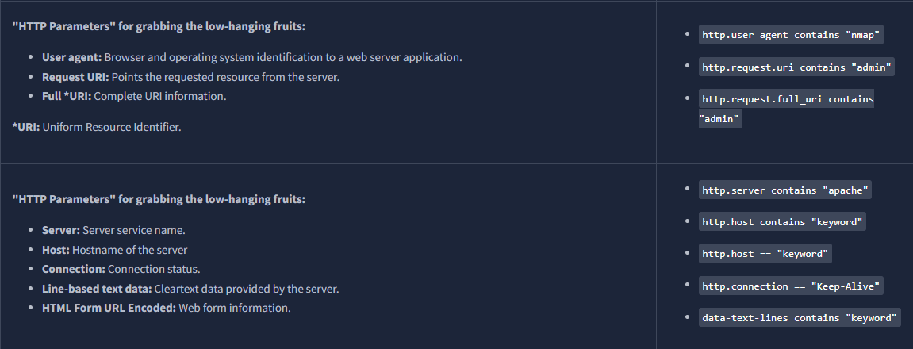
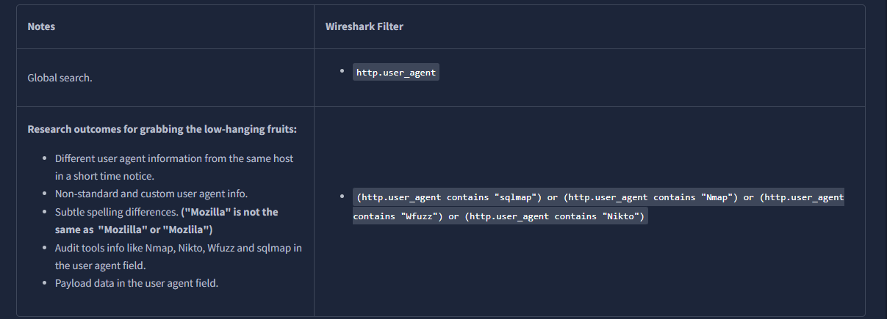
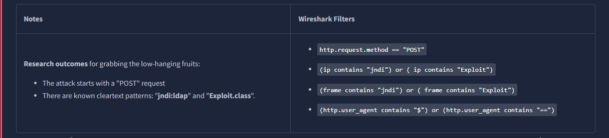

HTTP is used in attacks like: 
- Phishing pages
- Web attacks
- Data exfiltration
- Command and control traffic (C2)





- **200 OK:** Request successful.
- **301 Moved Permanently:** Resource is moved to a new URL/path (permanently).
- **302 Moved Temporarily:** Resource is moved to a new URL/path (temporarily).
- **400 Bad Request:** Server didn't understand the request.
- **401 Unauthorised:** URL needs authorisation (login, etc.).
- **403 Forbidden:** No access to the requested URL. 
- **404 Not Found:** Server can't find the requested URL.
- **405 Method Not Allowed:** Used method is not suitable or blocked.
- **408 Request Timeout:**  Request look longer than server wait time.
- **500 Internal Server Error:** Request not completed, unexpected error.
- **503 Service Unavailable:** Request not completed server or service is down.





Memory hook:
The **HTTP client software** is the thing that sends the HTTP request to the web server.
```
User-Agent identifies the HTTP client software, not only browsers.
```


`http.request.uri` is the **path/query part** the client requested from the server.

Example HTTP request:

```
GET /admin/login.php?id=5 HTTP/1.1
Host: example.com
```

Wireshark fields:

```
http.request.uri = /admin/login.php?id=5
```

```
http.request.uri = /admin/login.php?id=5
http.host = example.com
http.request.full_uri = http://example.com/admin/login.php?id=5
```

^^^^^^^^^^
WITH FULL URI

**1. Known keyword hunting**

If you suspect admin access:

```
http.request.uri contains "admin"
```

If you suspect web shells:

```
http.request.uri contains ".php"
```

or:

```
http.request.uri contains "cmd"
```

If you don’t know the URI, filter broadly:

```
http.request
```

Then add/view columns like:

Example request:

```
GET /login HTTP/1.1
Host: example.com
```

Wireshark field:

```
http.host = example.com
```

# USER-AGENT FOR SPOTTING ANOMALIES 





# LOG4J ANALYSIS - LOG4J vulnerability





```
An attacker sends a specially crafted string to an application.
The application logs that string.
Vulnerable Log4j interprets it and reaches out to attacker-controlled infrastructure.
That can lead to remote code execution.
```

