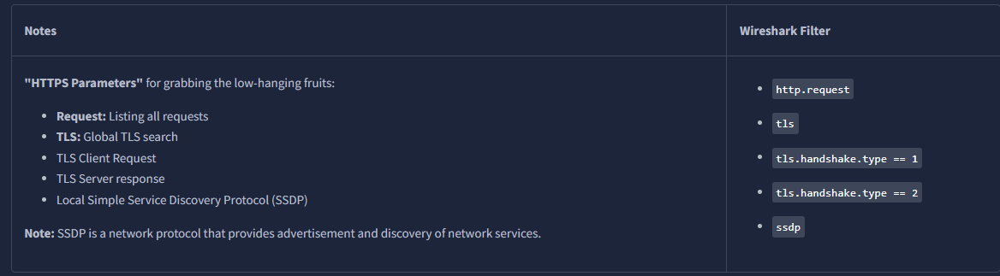

**Export Objects -> HTTP** can reveal files/resources transferred over HTTP.

It can pull out things like:

```
HTML pages
text files
images
scripts
documents
downloads
exfiltrated files sometimes
```

Identifying key pairs





**Client Hello**  
The client says:

```
“I want to start TLS. Here are the TLS versions/ciphers I support.”
```

```
tls.handshake.type == 1
```

**Server Hello**  
The server replies:

```
“Okay, we’ll use this TLS version/cipher.”
```

```
tls.handshake.type == 2
```

```
!(ssdp)
```

because SSDP can create noisy local discovery packets that are not relevant to HTTP/HTTPS/TLS analysis.

 As these processes are all accomplished in the browser, you need to configure your system and use a suitable browser (Chrome and Firefox support this) **to save these values as a key log file**

SNI means **Server Name Indication**. It is the hostname the client says it wants during the TLS handshake, like:

```
accounts.google.com
```

Wireshark filter:

```
tls.handshake.type == 1 && tls.handshake.extensions_server_name == "accounts.google.com"
```


