1. Network Traffic Basics 
**Objectives**:
- What is network traffic analysis 
- What can be observed 
- How to observer traffic 
- Know typic traffic sources and flows 

That's why we need to analyze traffic as firewalls and other devices might register these events but not their content. As threat actors can use records to send commands 
Usually the TXT record that contained a command would be read by the malware 
1. Why do we analyze network traffic? 
	1. Network performance 
	2. Abnormalities in network (slow, congested, drops, spikes)
	3. Expect content internally and externally 
2. SOC specifically 
	1. Detecting malicious activity 
	2. Reconstructing attacks 
	3. Verifying and validating alert 
3. 


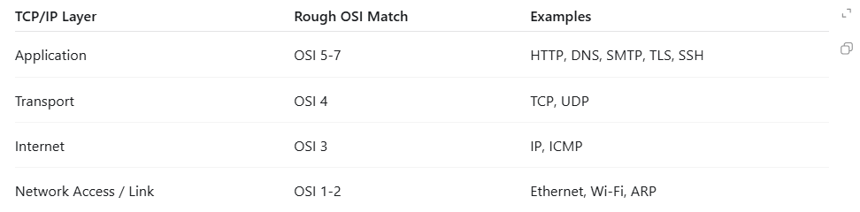


**What can we monitor?**


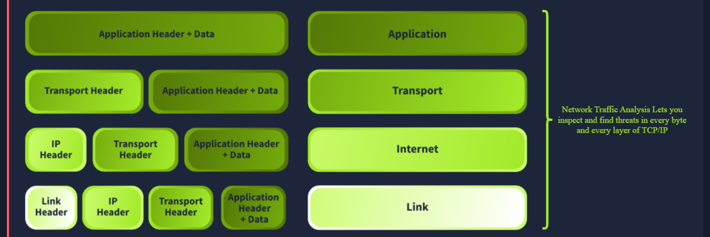


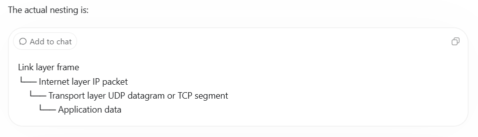


1. Application - the header and the data itself (payload)


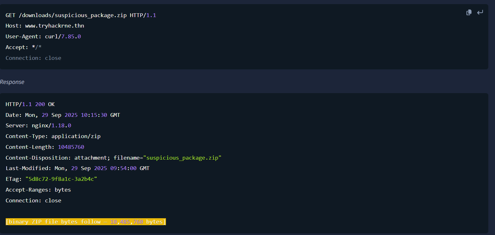


- **application** = broad category
- **zip** = specific subtype / file format
1. Transport 


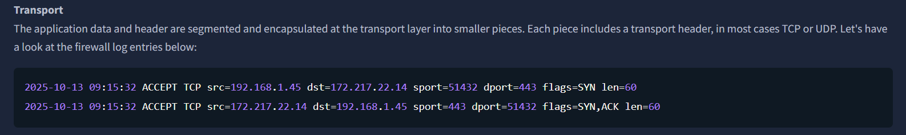


Firewall logs can 


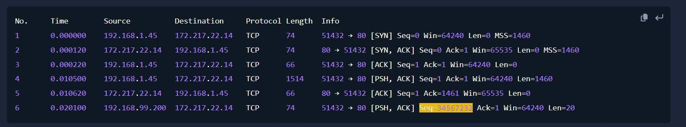


packet capture inspection from Wireshark

IP Fragmentation attacks:  happens when a packet is too large for the network path’s MTU. “This packet is too big, so split it into smaller IP fragments and reassemble it at the destination.”
A fragmentation attack abuses that process by sending fragments that are weird, tiny, missing, or overlapping so that:


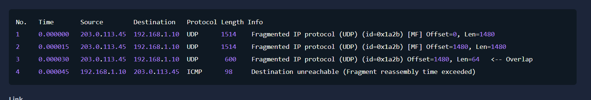


offset means data started at = value and len states next data should start at 1480 [MF] = more fragments coming 

above is suspicious since 2 and 3 states that both of them states that they contain the next starting 1480 packet 

packet 4 says it couldn't reassemble it. but to reassemble it, one has to be chosen and the other discarded. **The mismatch in packet is the evasion**

TCP Example 


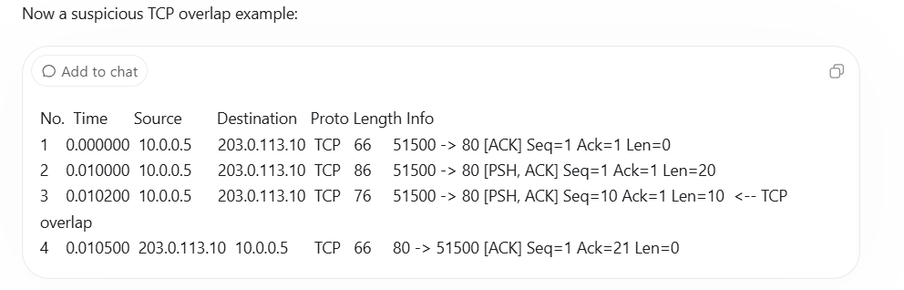

for the TCP overlap issue

2 will still be used, but depending on how it is reconstructed it may use the whole packet 2, or might use packet 3s 10-20
last byte = Seq + Len - 1. Because packet 3 starts at 10 and consumes 10 spaces, 10 included 
Not `10-20`.

Because 10 bytes starting at 10 are:

```
10, 11, 12, 13, 14, 15, 16, 17, 18, 19
```

for packet 4, we dont know if it's the good or the bad one since packet 2 covers 1-20, but we dont know whether bytes 10-19 are from the good packet or was replaced by packet 3 

So we can use sequence number and offset value to determine fragmentation attacks 

**SOURCES FOR TRAFFIC**
1. **Intermediary** - Devices through which traffic passes 
2. **Endpoint** - where traffic originates and ends 
3. **Flows** - Ingress (inbound)
		 Egress (outbound

**Obtained via**
1. Logs 
2. Full packet capture via Taps or Port Mirroring. Physical taps boasts little to none effect on performance 
3. Network statistics - metadata about the network traffic (NetFlow, IPFIX)
	1. IPFIX as a successor as it is vendor neutral. Only in V9 was NetFlow available to be used by others. Configurable via the devices 
4. C2 are often infiltrated via TXT records 
	1. C2 gets instructions, send commands 
	2. DNS Tunneling exfiltrates 


# Wireshark: Packet Operations
- **Objectives**
	- Investigate network traffic captures 
	- View statistics including summary and protocol details 
	- Uncover and apply packet filtering principles 
	- Apply protocol filters 
	- Apply advanced filtering 

# 1. **Viewing resolved addresses**


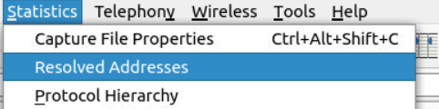


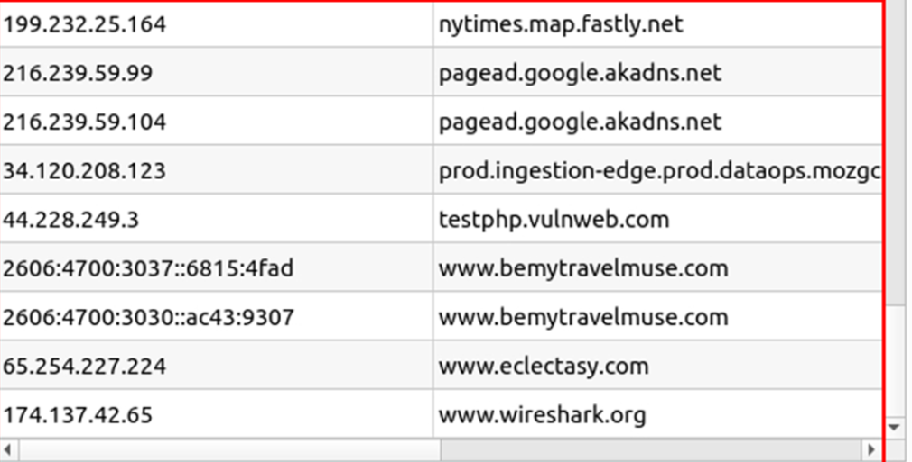


# 2. **Protocol Hierarchy** - views protocol in a tree. For viewing overall usage 
		**We can filter certain conversations and see a protocol hierarchy for that conversation**


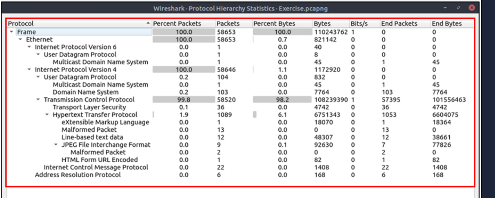


# 3. **Conversations -** can view all the conversations 
**Statistics -> Conversation**


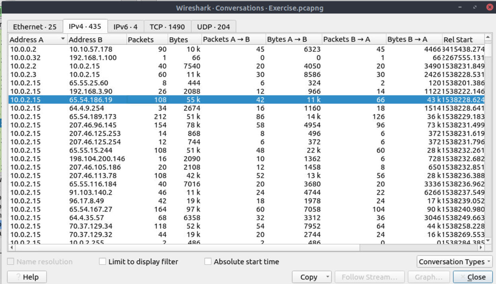


# 4. **Endpoint** - provides more information about the host 


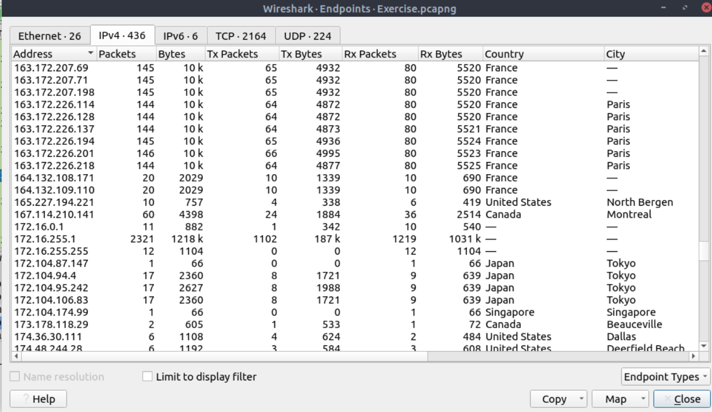


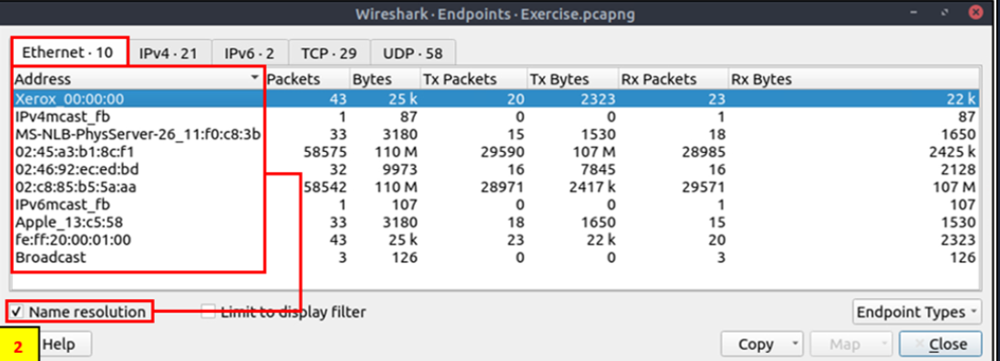


# **Check name resolution**

can also resolve name for **IP and and transport names**


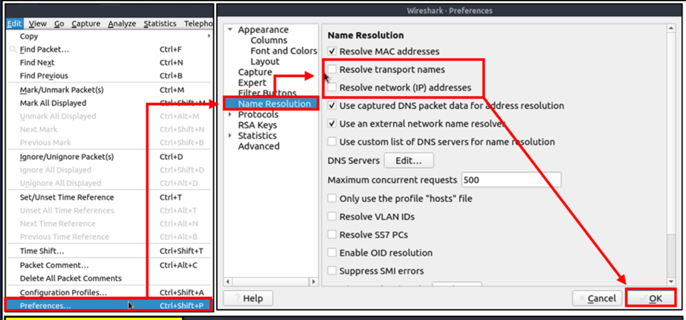


https://hackertarget.com/geoip-ip-location-lookup/


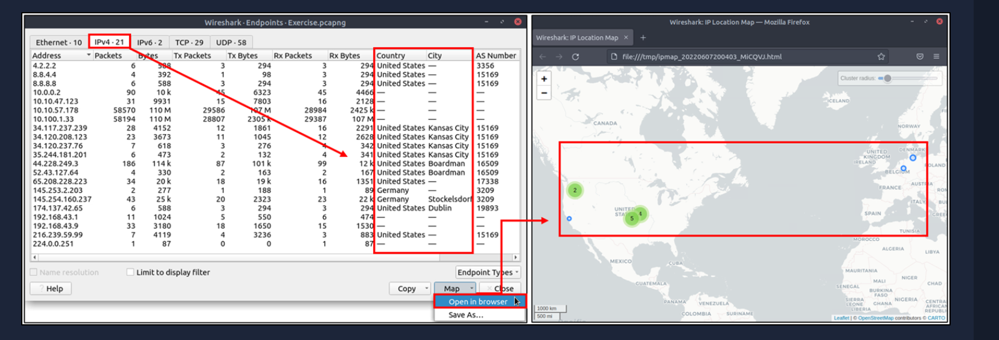


GeoIP extension for wireshark 


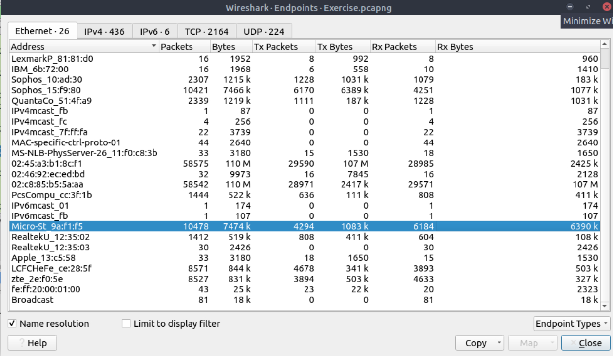


total bytes = **Tx + Rx or the Bytes** part

# 5. **In-depth view about IP addresses IPv4 and IPv6**


**Statistics** -> **DNS**

# **Statistics** -> **HTTP** 


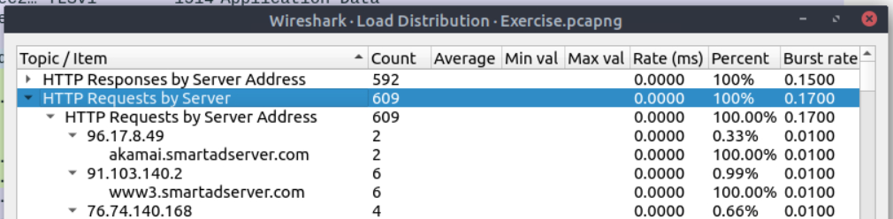


# **Statistics** -> **HTTP** -> **Request** 


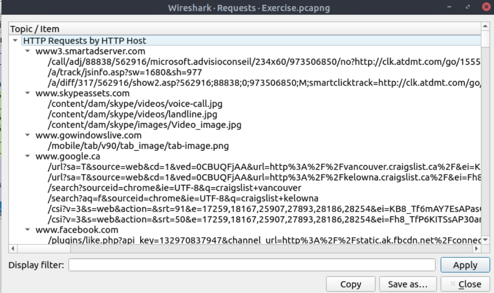


# **Statistics** -> **HTTP** -> **Request** **Sequence**


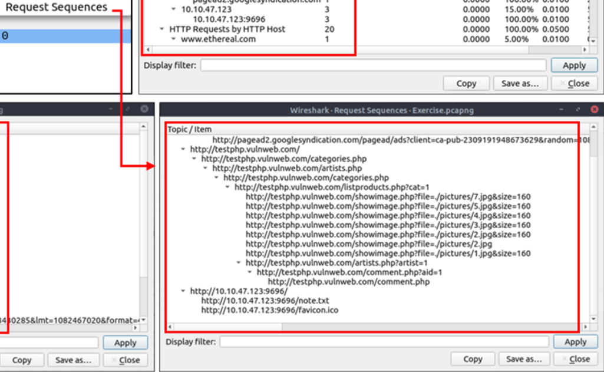


# Packet Filtering | Principles
Capture filters - before traffic capture 
Display Filters - Filtering the visible capture packets 

# Advanced Filtering 

