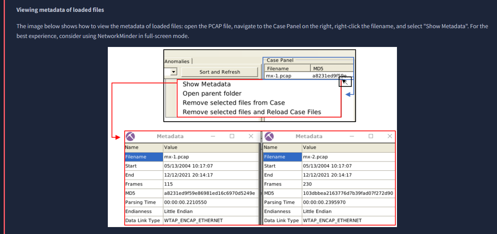

```
It passively parses the capture and organizes evidence for you.
Best for quickly seeing hosts, files, credentials, and artifacts.
```


Artifact in this case is valuable data extracted from packets 


# NetworkMiner in Forensics 

Provides:
- Context of captured hosts like their IP and MAC, hostnames, or OS information
- List of potential attack indicators or anomalies like traffic spikes or port scans
- Tools or toolkits used to perform the potential attacks like Nmap

Supports: 
- **Live Traffic**
- **Traffic Captures**
- **Log Files**

# Capabilities

1. Traffic Sniffing - intercept, collect, sniff, and log packets that pass 
2. Parsing PCAP Files - read the PCAP file, understand its structure, and extract meaningful information from it
3. Protocol Analysis - provides the used protocols from the PCAP 
4. OS fingerprinting - Can identify the OS 
5. File Extraction - extract images, htmls, and emails 
6. Credential grabbing - extract credentials from the PCAP file 
7. Clear text keyword parsing - can extract texts and strings from PCAP files 

# Operating Modes 

1. Sniffer mode - It has a sniffer mode, but it's unreliable and more on forensics 
2. Packet Parsing/Processing - parse packets to have overview and information on the investigated capture.
	1. Used for grabbing the low hanging fruit before deeper investigation 




