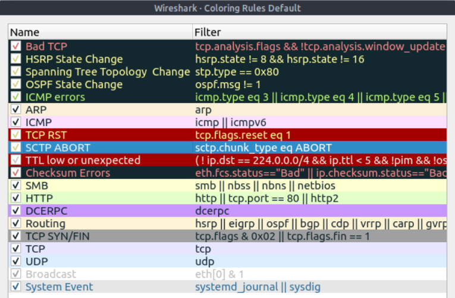
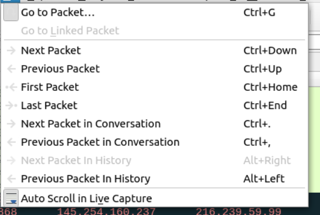
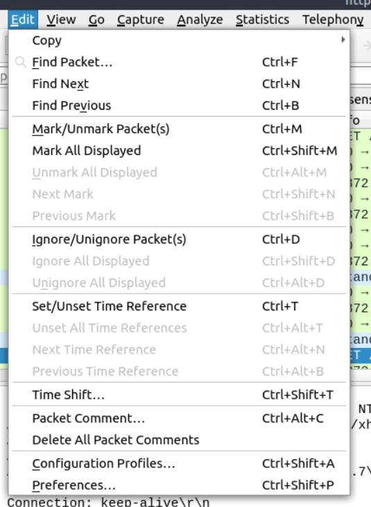
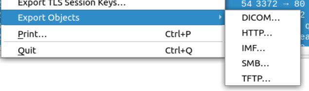
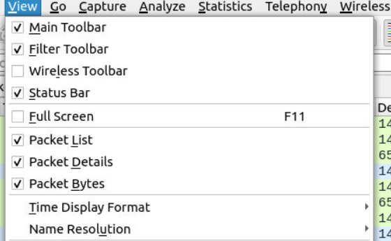
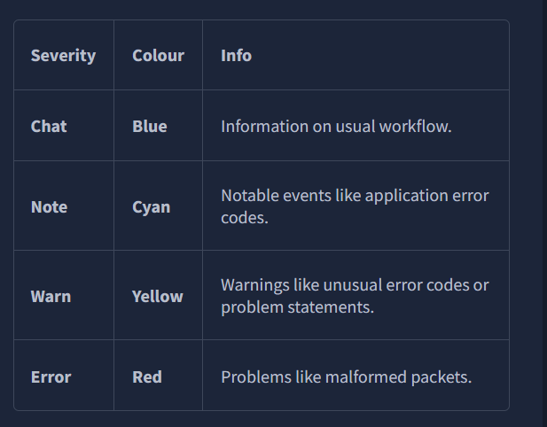
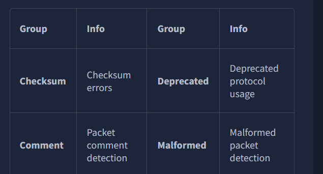
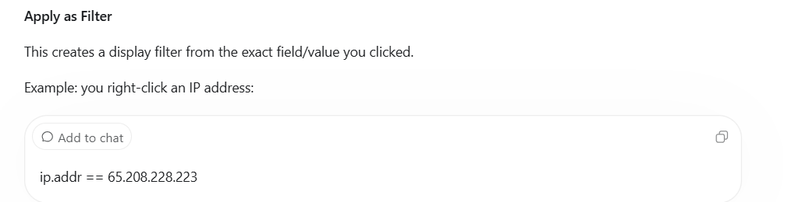
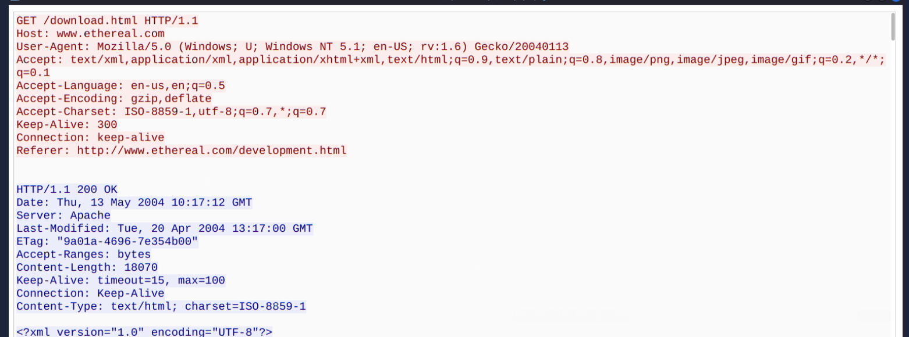

**Phishing** 
Identify the Artifacts 
Sender email address, IP 
Email Subject Line - usually urgency or call to action 
Recipient email address 
Reply-to email address - Where are responses being redirected 
Date and Time 

URLs and Hyperlinks 
Attachment name(s)
Attachment Hash
https://wheregoes.com/ - for shortened emails 
https://toolbox.googleapps.com/apps/messageheader/analyzeheader - analyzation for header 
https://mha.azurewebsites.net/ - analyzation for headers
https://ipinfo.io/dashboard - check ip 
https://urlscan.io/ - visit websites directly simulating a real session and all activity generated by the page 
https://talosintelligence.com/reputation_center/ - analyzes the reputation of IPs, Domains, Hashes https://www.convertcsv.com/url-extractor.htm extract URLs from mail or **Cyberchef**
Generating hashes of attachments and then checking them online for reputations like Talos or 
https://www.virustotal.com/gui/
**Sandboxes**
https://hybrid-analysis.com/ - gives comprehensive review of its behavior 
https://www.joesandbox.com/#windows - can perform both static/dynamic 
https://www.phishtool.com/ automates the process for centralizing the analyzation of suspected phishing activities, helps in extracting artifacts. integrated with VirusTotal, Mirrors documentation
**Wireshark** - sniffing and packet analyzer

Can **Merge**, can **sniff**
View Statistics for - hash, capture time, capture file comments

GO TO PACKET OP 

searching is kind of OP too 
**Marking packets** 
**Commenting on packets**
**Can export specific packets**

CAN EXTRACT WTFFF OP 

Changing time for better look 

Analyze -> Show Expert Info to get analyzation 

**Click on the row -> apply filter, and it'll focus on that**

Conversation filter - for the conversation of two hosts 
Colourise conversation 
Prepare as filter to just choose but still not apply it until so
Apply as column adds a column based on the packet details that you chouse 
Follow stream 

