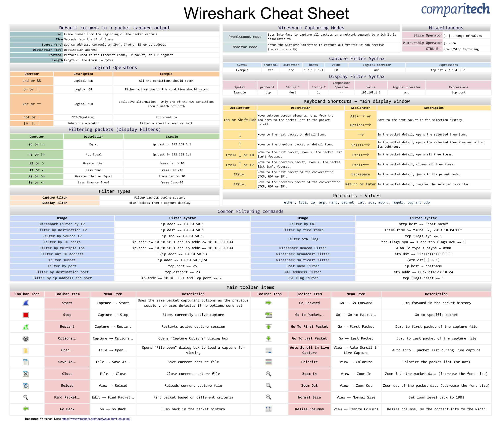

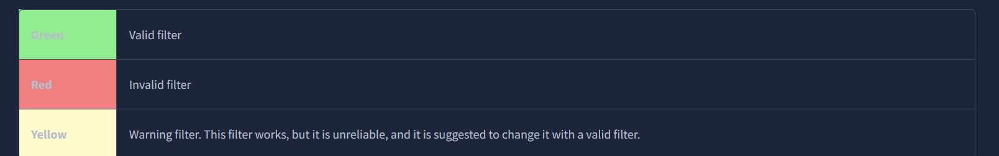

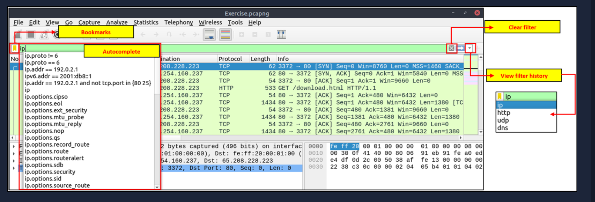

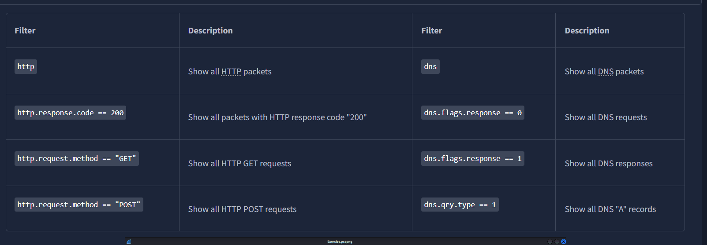

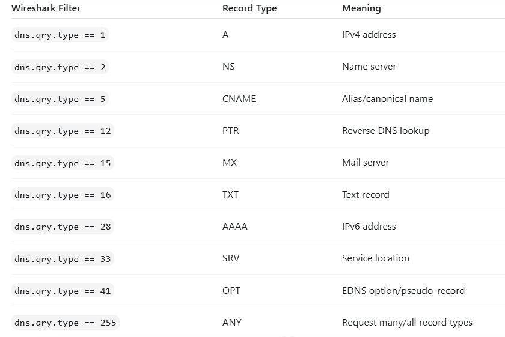

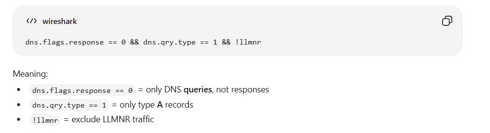

LLMNR = **Link-Local Multicast Name Resolution**.
# Server 
It is Windows/local-network name resolution, often used when DNS does not answer.

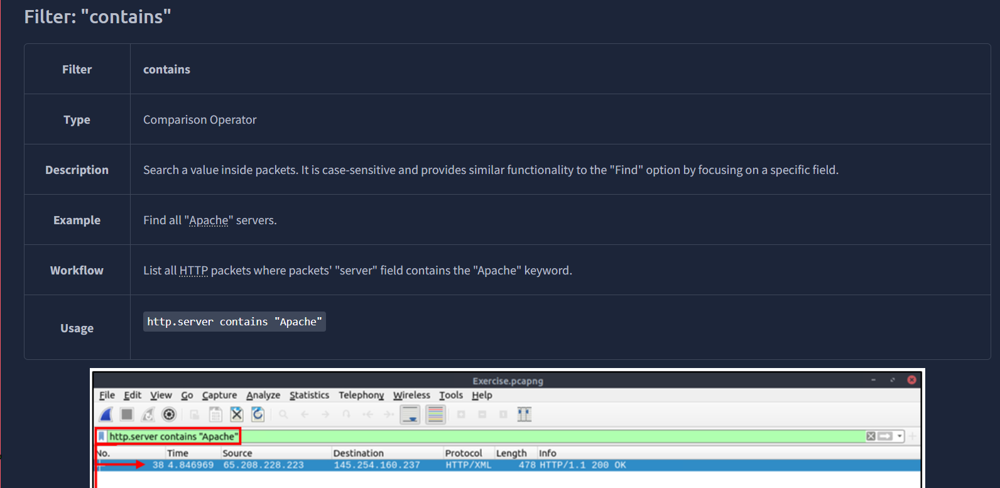

# Host Header

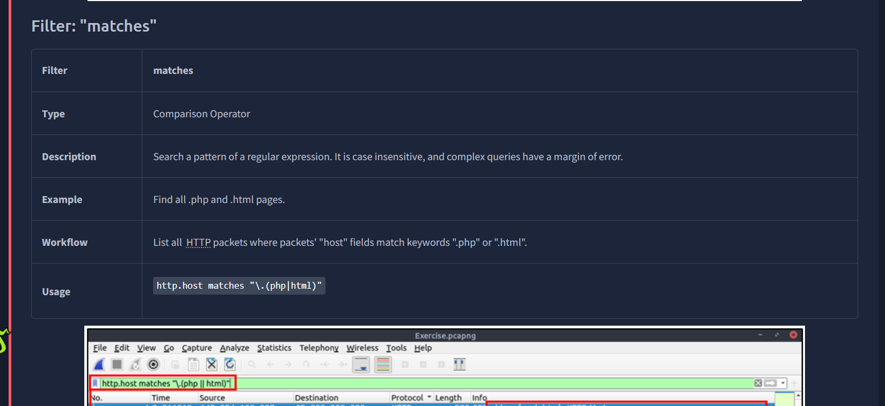

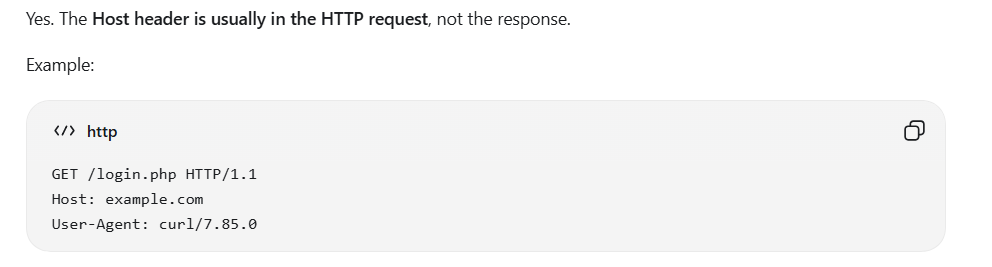

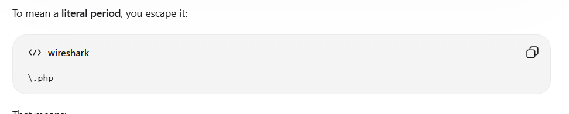

# IN Membership clause 

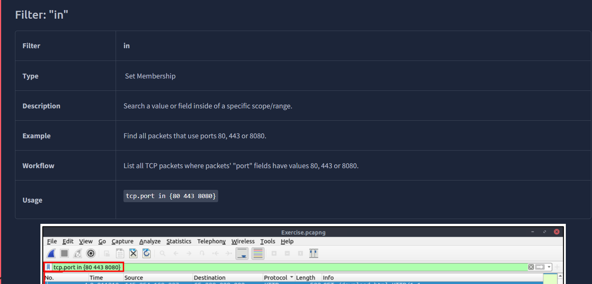

# UPPPER Clause 

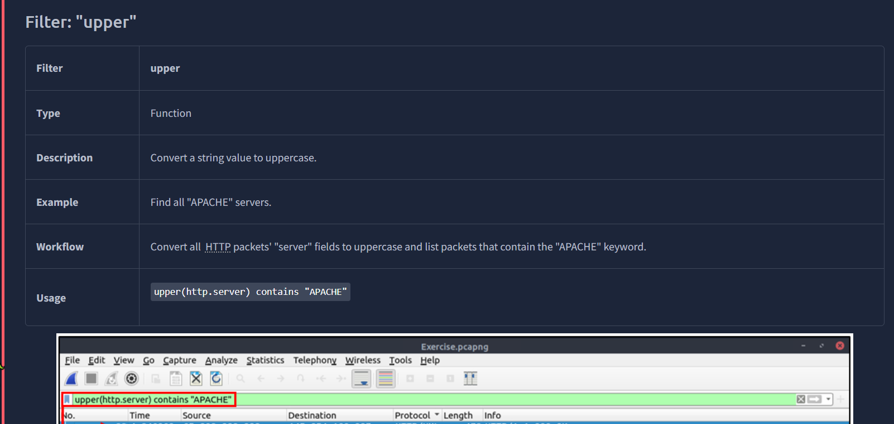

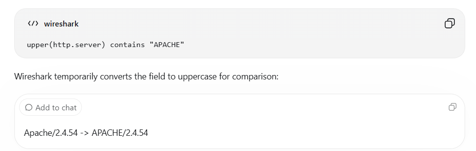

# Lower Clause 

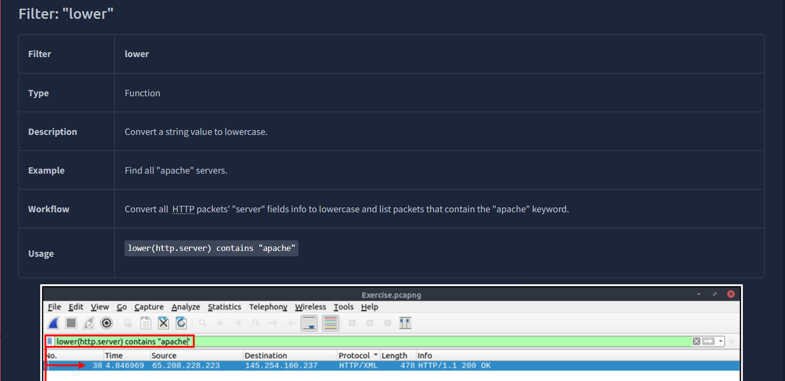

# String

# Bookmarking 

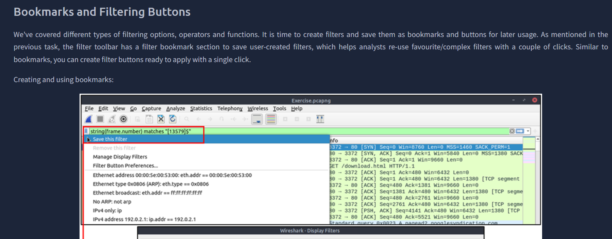

# Creating Profiles

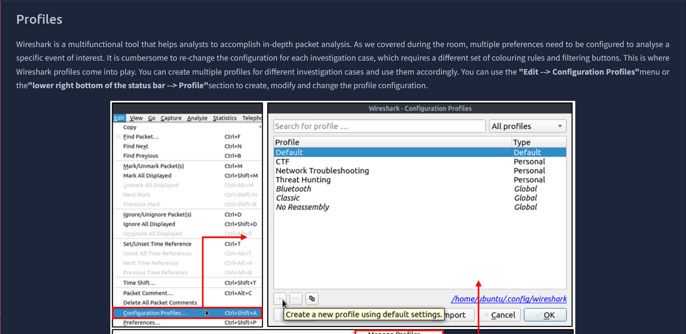

