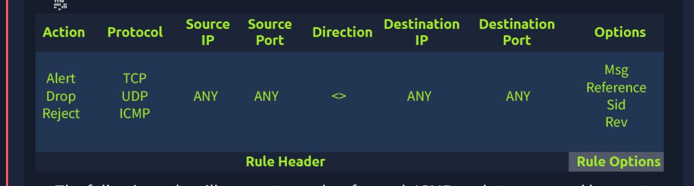
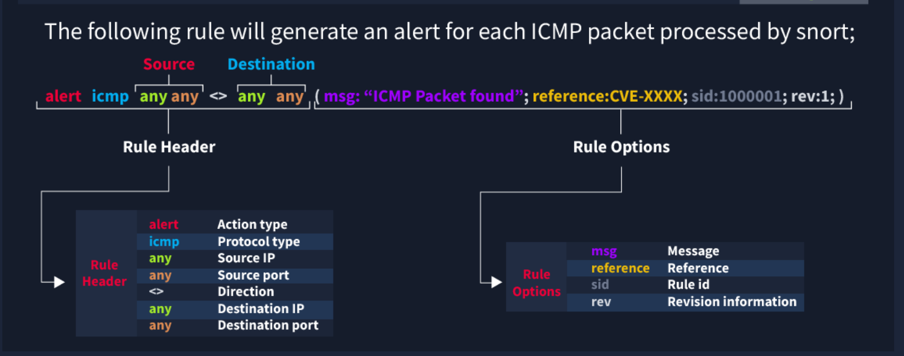
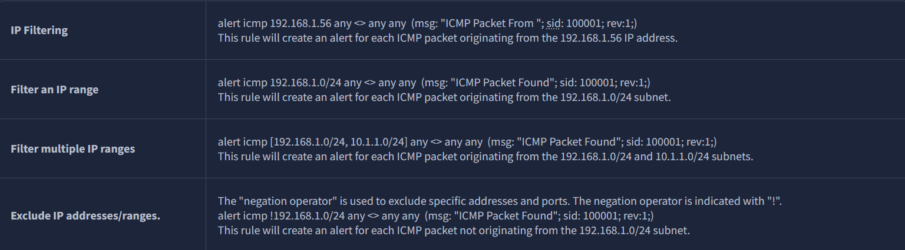
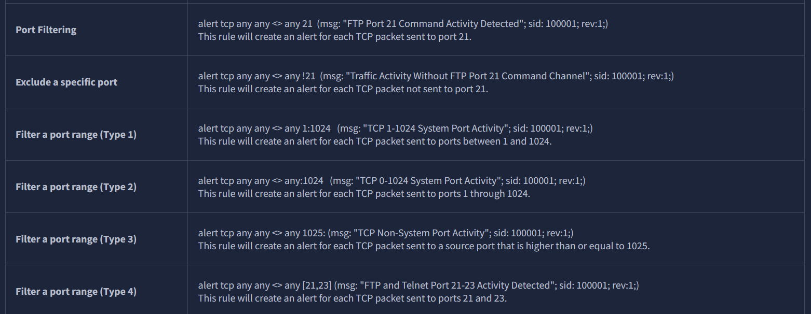
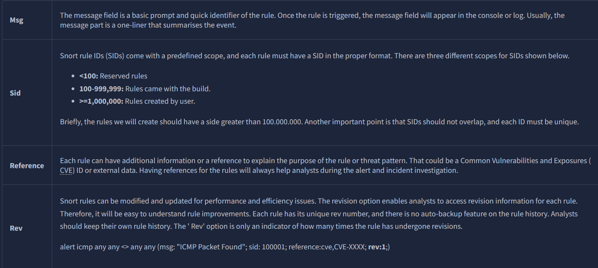
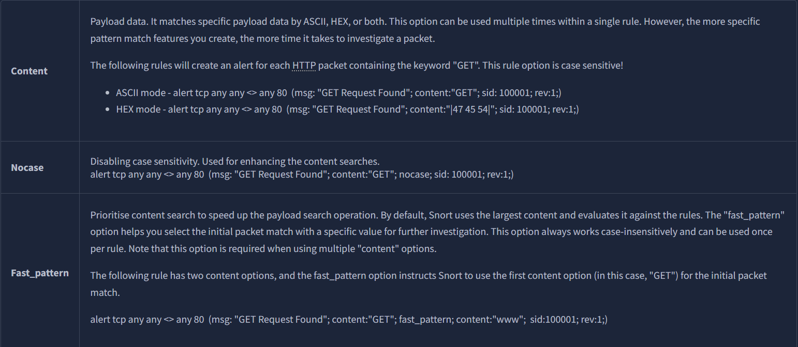

Alert (Type of action)- IDS 
Reject (Type of action)- IPS


Actions for rules:
1. Alert - generate and log 
2. Log 
3. Drop - block and log the packet 
4. Reject - block the packet, log it, and terminate the packet session 

Protocols: 
1. TCP
2. UDP
3. ICMP
4. IP

# For IP 





# For Ports 





Direction 

-> source to destination
<> bidirectional 

# Rules options 





# Payload options within rules 





for fast_pattern, it checks the initial rule and if it's there it checks the rest of the rule 

```
GET found + www found     → This rule can alert
GET found + no www        → This rule does not alert
No GET                    → Snort skips this rule quickly
```

# Non-Payload Data Rule Options 


Once a rule is created, it should be in a local rules in "local.rules" where it is located in /etc/snort/rules/local.rules

for editing rules 
```
sudo gedit /etc/snort/rules/local.rules
```


