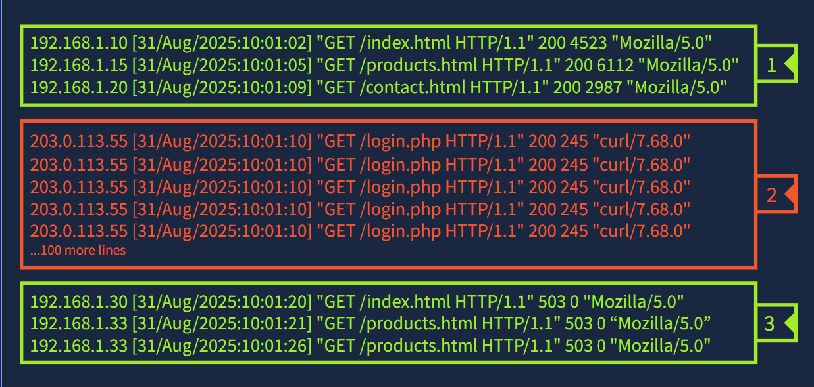

- attacks the availability of the app and its services 

# DoS 
one sender -> website 

Input data can be targetted here again, requests that can crash the underlying database 
or flood it with many requests 

# DDoS 
many sender -> website 

Botnets, reflected DDoS, Amplified DDoS 

Types of attacks: 
1. Slowloris - many partial http request to tie up server resource 
2. HTTP Flood - Sending lots of HTTP requests 
3. Cache bypass - bypassing CDN servers to connect to the origin server 
4. Oversized query - forces large requests 
5. Login/Form Abuse - 

# Indicators for Dos/DDoS

1. High request rate - 10.0.0.0 -> GET /login
2. Odd user agents 
3. IP address, impossible travel 
4. Burst timestamps 
5. 503 errors 
6. Logic abuse - GET /products?limit=999999

# Targeted resources 
1. Often target intensive resources like w/ databases 
	1. /login
	2. /search
	3. /api - critical for delivery 
	4. /register /signup
# Log Sample 

1. Normal requests 
2. Burst of attempts 
3. 503 error 

# Tools for Defending

**Secure Development Practices**
- secure coding
- input validation 
**Challenges**
- CAPTCHAS to avoid bots 
- JScript for UBA to see if real human or not 
**Network and Infrastructure Defense**
- CDNs - Allows CDNs to take hits and not the original server 
- Provides load balancing
**WAF**
- Inspects traffic, even encrypted ones 
- Knowledge-based
- Signature-based 
- Custom rules 

**Bypassed security measures**
- CDN might server a cached URL at /products
- Adding random parameters like /products?a=abcd, CDN doesn't respond and the origin server responds 
- Changing user agents 
- Spoofing referrer pages 
- Launching requests from diverse geographic regions 
