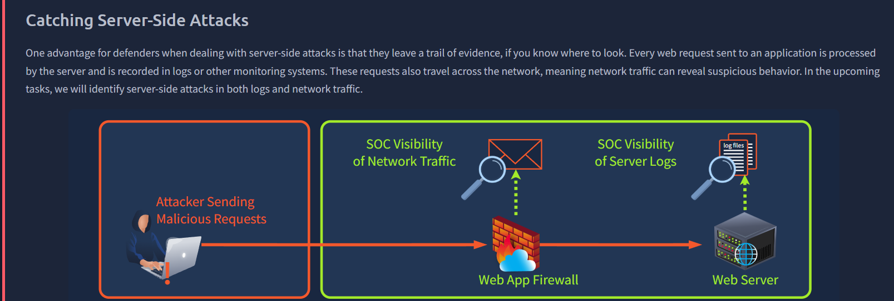
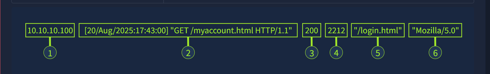

# Client-Side Attacks (Less visible in SOC)
- abusing weakness in user behavior or on the user's device. 
- Exploits vulnerabilities in browsers 
- Tricking users to perform unsafe action to gain access to accounts 

Limitation: 
1. SOC usually can only monitor traffic from inside 
2. Client is from outside the network, so little to none visibility on what occurs on the user's browser 

**Common attacks**
1. XSS (Reflected or Stored) - embedded within the web code, and then executed by the user's browser. Attacks input boxes
2. CSRF - sending unauthorized request on behalf of a trusted user 
3. Clickjacking - Attackers overlay invisible elements on top of legitimate content. Trust on that content but has underlying element. 

# Server-Side Attacks (Visible in SOC)
- exploits vulnerabilities within a web-server, the applications code, or the backend. 
- exploits flaws 
- vulnerabilities
- server logic 
- misconfigurations 
- input handling
Attackers can: 
1. Gain access
2. Steal information 
3. Cause damage to running services 

Logs from firewall, the server itself, and monitoring systems, and the network traffic 

**Common Server-Side attacks**
1. Brute-force - attempts different usernames or passwords to gain access to an account. 
	1. Fast
	2. Automated tools 
2. SQLi - attacks the database 
	1. string concatenation instead of using parameterized queries
3. Command injection - website takes user input and passes it to the system without checking. Attackers can sneak in command, making the server run commands with the same permission as the application 

# Log-Based Detection

Web server can leave evidence in its access and server logs. 

1. Client IP
2. Timestamp + Requested Page 
3. Status Code 
4. Size
5. Referrer - where it came from 
6. User-Agent - can b
7. e browser, can be tools 

Example of attack sequence
1. Directory fuzz, checks what paths exist 200 means it exists, 404 means no 
2. Can do POST requests for login page, bruteforce (302) successful login attempt

Limitation of logs:
1. You can't see the contents
2. It depends on how a log is presented too 

# Network-Based Detection 
- Provides deeper analysis for web as it gives out more detail about the different parts of the TCP/IP stack 
SQLi can be things like: 
1. Login SQLi
2. Search SQLi- provides information that you weren't supposed to have access to
`%%` in sql means anything, that's why it's used in SEARCH SQLi
 3. SQLMap is an automated tool for detecting and exploiting SQL injection vulnerabilities. After reviewing the network traffic, you see that the requests include SQLi payloads.
# Web-Application Firewall
- Basically the gatekeepers of websites and web applications
- Inspects full request packets 
- AND CAN DECRYPT TLS 
Of course it has rules 
1. Block common attack patterns - block from user-agen sqlmap
2. Deny known malicious sources - block IPs 
3. Custom-built rules - Allow specific requests
4. Rate-limiting and abuse prevention - Limit login attempt 

WAFs provide CAPTCHA for bots 

