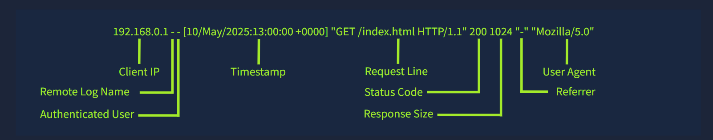

Code runs on server 
.aspx for Microsoft servers 

**QUERY STRINGS ARE MAIN CONCERN HERE** 
# Workflow 
```
1. Alert/WAF log: What rule fired? Was the request blocked or allowed?
2. Web access logs: What URL was requested? What happened before and after?
3. Firewall/network logs: Which client and server communicated?
4. EDR/server logs: Was a file created? Did the web-server process run anything?
5. PCAP, if available: Examine the traffic in more detail.
```

For LINUX acces logs CLI 
grep -nF "Vlaue name in log" access.log

find /var/www -type f -name 'shadyshell.php'

cat shadyshell.php
# Wireshark filters that are key
1. http.request.method == POST 
2. http.request.uri contains ".php"
3. http.user_agent

Follow stream after that 


They can use this for: 
1. Initial foothold 
2. Provide remote access 
3. And other actions in the attack chain 


# What is a web shell ? (Initial Access and Persistence)

1. What they are? 
	1. A malicious program uploaded to a target web server 
	2. Enables adversaries to execute command remotely 

# Web Shell Deployment can be done through: 
1. A file upload vulnerability 
2. Misconfiguration
3. Prior access to the system 
4. Bad input validation 

# They run because of 2 things 
1. bad input validation 
2. It treats the file as an executable 

# Anatomy of a Web Shell 

1. They abuse functions() 

# Log-based Detections 





# HTTP requests in rapid succession
1. Directory fuzzing, repeated GET requests to different paths 
	1. Attacker is checking where he can upload web shells 
2. POST requests after Directory Fuzzing 
3. Repeated GET or POST requests to the same file 


```
Web/WAF logs       → requested path, query string, status, source IP
Application logs   → what the app recorded about the request and its result
EDR telemetry      → files created, processes started, command lines
File collection    → actual contents of a file, if it still exists and collection is permitted
```

# Request methods to be aware of 
1. GET - used for recon or interacting with web shell
2. POST - Uploading or interacting with web shell 
3. PUT - uploading a web shell 
4. DELETE  - Cleanup methods 
5. OPTIONS - request methods that are supported = reconnaissance 
6. HEAD - similar to GET but only returns headers - For detecting files 


200 OK 
404 Not Found 
200 Directory Found 
200  Form Found 
200  Web shell uploaded 

# So the flow can be like: 
1. Looking for directory (Directory Fuzzing) (GET)
2. Uploading PHP (POST)
3. Web shell access (GET or POST)


# Suspicious User-Agents & IP Addresses 
1. Altered user agents 
2. Outdated user agents 
3. Blacklisted user-agents 
4. Suspicious IP addresses 

# Query String 
1. long or suspicious strings, cmd= or exec= 
2. Encoded query strings, query=whoami becomes query=d2hvYW1p
	1. The web shell can decode it and then execute it 
3. Missing referrer
	1. Doesn't mean automatically bad 
	2. Because of directly typing the URL 
	3. Bookmarks 
	4. Or if an attacker directly requests the web shell 

# Suspicious web request would look like 
1. Known or malicious IP 
2. Out of cycle logging 
3. POST with weird queries or to files 
4. No referrer, meaning it was directly accessed 

# Linux tool for tracking 
Auditd 
Ausearch for matching rules 
eg. 
ausearch -k web_shell for matching rules 
 creat, for checking i file was uploaded 
 execve, ran commands

# SIEM Platforms can help by: 
1. Centralized log collection and correlation
2. For multiple logs 
3. Targeted queries for searches 

---
# BEYOND LOGS
- If a POST was successful it might be stored somewhere
- Checking web server files are crucial 
	- For uploaded or modified files 

**Common web server directories**
1. Apache /var/www/html/     default on linux distros
2. Nginx /usr/share/nginx/html/ on many linux setups 
3. Uploads
4. Images
5. Admin
6. tmp

**Monitor files with executable extensions**
1. .php or .jsp 
2. double extensions
```
find /var/www -type f -name "*.php" -newerct "2025-07-01" !newerct "2025-08-01"

-newerct "2025-07-01"     → changed after July 1
! -newerct "2025-08-01"  → NOT changed after August 1
```

```
grep -r "eval(" wp-content

checking for functions that might contain "eval"
```

