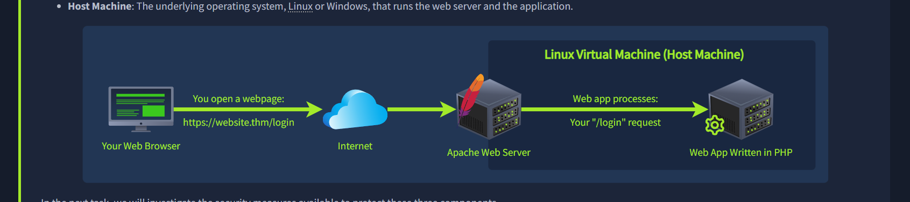

Introduction of SaaS means the introduction of a new attack surface

Web abuses the Request - Response from client to server 

Components of a Web Service 
1. Application - The code, images, styles, and icons dictate how the website looks and functions
2. Web Server - hosts the application itself, listens for requests and returns a response to a user 
3. Host machine -  the underlying OS, Linux or Windows, that runs the web server and the application

Most common web servers that we might encounter: 
1. Apache - simple  
2. Nginx - high-performance
3. Internet Information Services (IIS) - Microsoft-developed web-server

Client -> Server -> Machine 

# Protecting the Web 

Application
1. Input validation 
2. Secure Coding 
3. Access Control

Web server 
1. Logging - keep a record of all web requests with access logs 
2. WAF - 
3. CDN - reduces direct exposure to server and use integrated WAFs 

Host machine 
1. Least privilege 
2. System hardening 
3. Antivirus 

For all three
1. Strong authentication - don't just let anyone access the components 
2. Patch management - Ensure everything are up to date 

# Logging 

Web server logs are called access logs 

Access logs are valuable for SOC because they track information about every interaction. 

GET - to look for directory discovery/traversal using gobuster 
POST - look for weird uploads in paths that require input 

# Defense Systems 

CDN (Content Delivery Network)
- stores and serve cached content from servers close to the user so they don't directly access the main server. Provides efficiency and reduces latency. 

Benefits: 
1. IP Masking - hides the origin IP address 
2. DDoS protection - CDNs can absorb large amount of traffic 
3. Enforced HTTPs - most CDNs require TLS 
4. Integrated WAF 

WAF 
- Inspect incoming HTTP traffic and takes action based on predefined rules. 
Can fire based on: 
1. Signature - example would be it matches a known tool 
2. Heuristic - analyzes context and behavior - fire if long query and weird characters exist
3. Anomaly - a single IP address making repeated login attempts in a short time 
4. Reputation - checks IP for their reputation 

AV 
- Can help detect malicious files by comparing to its database
- Such as file uploads, web shells, post-exploitation tools, and other malicious software 
