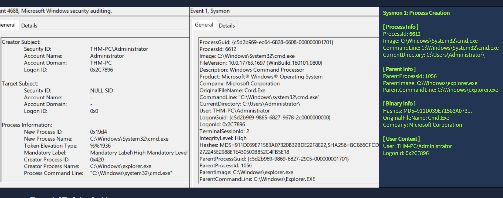
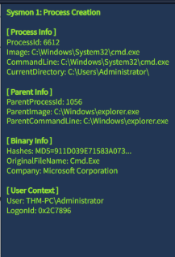
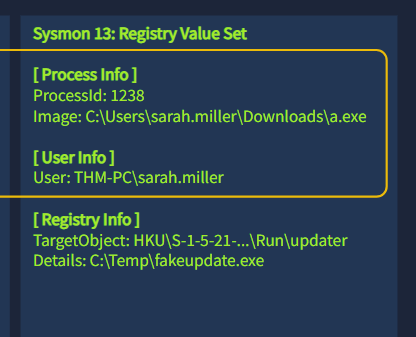
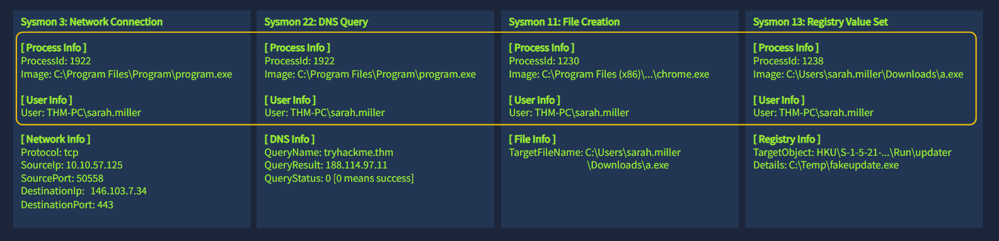

4688 basically any process that is launched 
1 Sysmon, installation is needed , replaces 4688 and provides more advanced field 





parent info for detecting weird process command execution. 

like a word launching a process 

PID and Process ID is useful for creating a timeline and for deeper analysis 

Red Flags for processes: 
1. Image is in an uncommon directory 
2. Process is suspiciously named 
3. Hash matches a malware 

Review parent process group, red flags are
1. Parent matches red flags 
2. Parent is not expected like word executing something 

Process ID:
1. Check process ID and if it also is a Parent Process ID 





2. Process ID = Parent Process ID 
3. Name of the process 
4. Hash of the process
5. Weird Parent Process 
6. Logon ID from previous instances
Event 15 for file stream to look where it was downloaded 


# Files and Network 
```
Sysmon 11 - File create 
Sysmon 13 - Registry Value Set
``` 

Detect files dropped by malware or its changes to the registry

```
Event ID:     13
Image:        C:\Windows\System32\WindowsPowerShell\v1.0\powershell.exe
TargetObject: HKCU\Software\Microsoft\Windows\CurrentVersion\Run\Updater
Details:      C:\Users\Alice\AppData\Roaming\update.exe
User:         COMPANY\Alice
```

Image
- Process that performed the action 
TargetObject
- Defines registry location and value named Updater  
Details 
- PowerShell placed inside the value 





```
HKLM\Software\Microsoft\Windows\CurrentVersion\Run registry are applications that Windows start automaticcally when user signs in
```
a.exe with process sarah
changed the registry value \updater to a string pointing to a malicious fakeupate.exe 


# Network Connection DNS Query 

``` 
3 - Network Connection
22 - DNS query for the DNS resolver
```





Sysmon 3 means that the process program.exe initiated a connection to the destination IP 

```
<QueryList>
  <Query Id="0" Path="Microsoft-Windows-Sysmon/Operational">
    <Select Path="Microsoft-Windows-Sysmon/Operational">
      *[EventData[Data[@Name='ProcessId']='1922']]
    </Select>
  </Query>
</QueryList>
```

Filtering out a PID 

1. Your red flags for network connection events are:
    - Connection to external IPs on port **80** or on non-standard ports like **4444**
    - Connection to known malicious IPs (e.g. by checking on [VirusTotal(opens in new tab)](https://www.virustotal.com/gui/home/search))
    - DNS queries to suspicious domains (*.top, *.click, or hpdaykfpadvsl.com)
2. Your red flags for file and registry changes are:
    - Files dropped to staging directories like **C:\Temp** or **C:\Users\Public**
    - Dropped file is a script (**.bat** or **.ps1**) or an executable file (**.exe** or **.com**)
    - Created files or registry keys are used for persistence (soon on it later!)


