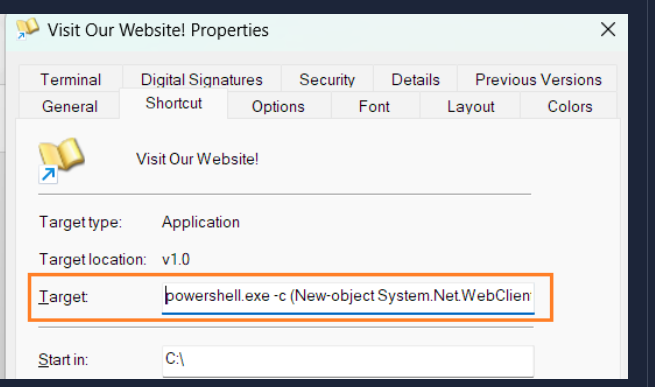

**Initial Access**
- The first instance of an attacker when it gets in

**Example types of Initial Access**
1. **Exposed Servies**
	1. T1133 - Remote access via RDC/VNC/SSH (vulnerabilities with weak access control)
	2. T1190 - Misconfiguration Vulnerabilities
2. **User-Driven Methods**
	1. Phishing - T1566
	2. Removeable Media - T1091

**Initial Access via RDP**
RDP as a large attack vector that many people call it the 
```
Ransomware Deployment Protocol 
```

Brute force attempts - 4625 - 4624(failed logins, along with following the flow of when the first success login was authenticated)

Logon ID of 4624 and then correlate the session

Block RDP for mitigation 

# Phishing as Initial Access
**Example Types of Phishing**
1. Binary attachments 
	1. Files that are executed, specially extension are not .exe but can be hidden like .exe in a .pdf file 
2. LNK Attachments 
	1. Avoids AV detection
	2. Attaching to PS, VBA, BAT Scripts 

**Binary Attachments** - may execute directly
- a file containing executable machine code 
**LNK Attachments** - shortcut that tells what to execute 
- Inspect that target itself, not the LNK shortcut 
- LNK is a Windows shortcut that points to another application or program
- Scripts are hidden in LNK Shortcuts 





