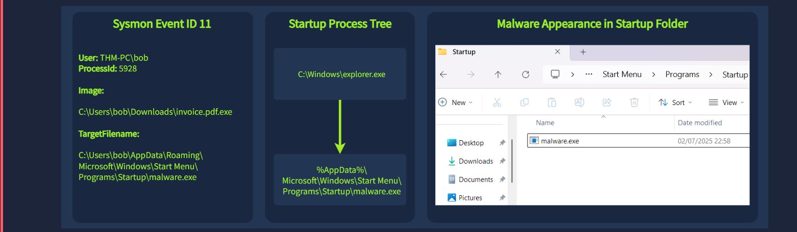
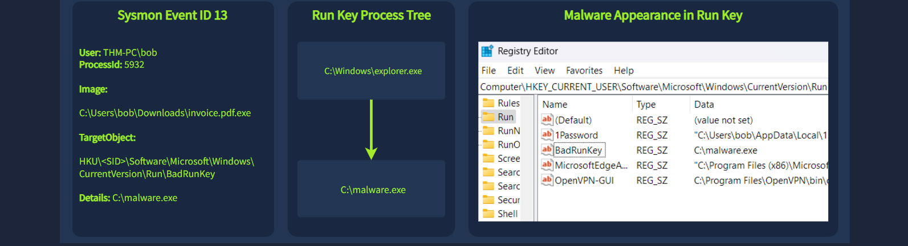

- Runs when a specific user logs in 
- Windows provides per-user persistence that are used in legitimate tools and malware 


# Add malware to startup folder 
- Runs on user login 
```
copy C:\malware.exe  
"%AppData%\Microsoft\Windows\Start Menu\Programs\Startup\malware.exe"
```
Sysmon 11: New Startup Item

# Detecting Startup
Startup is usually in: Specific for users because you can target users 
```
C:\Users\<USER>\AppData\Roaming\Microsoft\Windows\Start Menu\Programs\Startup\ Or for all users: C:\ProgramData\Microsoft\Windows\Start Menu\Programs\StartUp
```

Monitor Sysmon 11: New Startup Item
Launched files via startup will have explorer as parent 





# Add malware to "Run keys"
- Runs on user login 
```
reg add "HKCU\Software\Microsoft\Windows\CurrentVersion\Run"  
/v BadKey /t REG_SZ /d "C:\malware.exe"
```
Sysmon 13: New Registry Value 


# Detecting Run Keys 
Run Keys are usually contained in: 
To view it we can run: regedit.exe or Registry editor
```
HKEY_CURRENT_USER\Software\Microsoft\Windows\CurrentVersion\Run  
Or for all users: 
HKEY_LOCAL_MACHINE\Software\Microsoft\Windows\CurrentVersion\Run
```
Sysmon 13: Registry changes 





Wherein BadRunKey stores malware.exe

