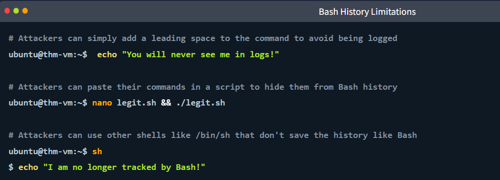
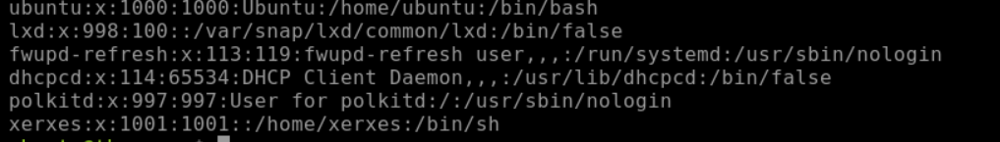

Common file logs: 
```
`/var/log/kern.log`: Kernel messages and errors, useful for more advanced investigations

`/var/log/syslog (or /var/log/messages)`: A consolidated stream of various Linux events

`/var/log/dpkg.log (or /var/log/apt)`: Package manager logs on Debian-based systems

`/var/log/dnf.log (or /var/log/yum.log)`: Package manager logs on RHEL-based systems
```

Aren't usually seen in daily SOC activities, since it's noisy


# App-Specific Logs 
An example would be the Nginx web server logs in: 
```
cat /var/log/nginx/access.log
```

# Bash History 
```
cat /home/ubuntu/.bash_history
```
Rarely used in SOC since it does not track non-interactive commands like CRON jobs, web servers, OS 
	By non-interactive, it means a command runs without  a person actively typing commands

So attackers can: 





For installation I can look at: 
```
/var/log/dpkg.log
```

To look for accounts: 
```
cat /etc/passwd
```
Ubuntu user accounts usually start at 1000 and history is usually stored at home directory indicated in 




/home/ubuntu or /home/xerxes