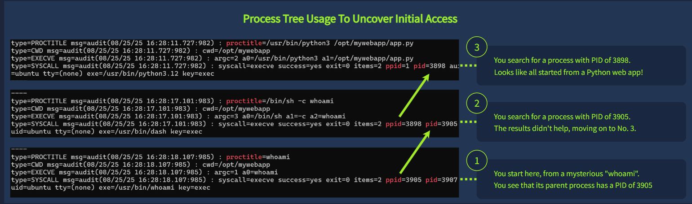

- Raw application logs are not so useful when it comes to SOC 
- Instead SOC relies on **process tree analysis**





We start by examining one suspicious entry and following it's parent ID to see where it originated

PROCTITLE - describes how a process was launched 
So: 
```
/usr/bin/python3 

was started to run the application

/opt/mywebapp/app.py 
```

By using ausearch we can do it by by invoking the flag -x which let's us search for an executable given in the PROCTITLE 
```
ausearch -i -x whoami

given that this is the suspicious entry in the logs, we then follow the parent ID of it PPID
```

```
ausearch -i -pid num
```


We can also invoke all the child processes of our initial executable 
```
ausearch -i -ppid num | grep 'proctitle'
```

So the flow would be: 

# 1. Suspicious event in the logs 
```
ausearch -i -x [proctitle in question]
```

# 2. Follow the events 
```
ausearch -i --pid [parent ID of the proctitle in question]
```
- do this until it reaches the end 
# 3. Additionally, we can list child processes 
```
ausearch -i --ppid [main paren process of the events]
```


