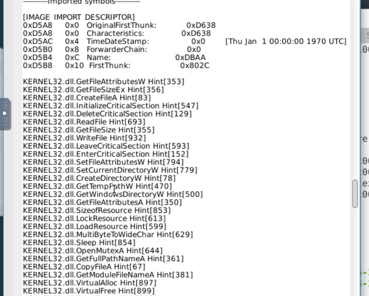

- Contains metadata about a PE file. 
- What is PE exactly?
	- Portable Executable. File format in windows that uses executable programs and libraries 
- What is a PE File?
	- Binary version of the program, contains the information Windows need to load and run it 

PE File 
- Contains all the code that it needs to run on a system
- Sometimes uses code provided by the OS 
- Imports are from outside to perform different tasks 
	- Ex. If it wants to query a Windows Registry Value, they will import the RegQueryValue function provided by microsoft
	- This Function is presented on all windows machine 
	- So it doesn't need to be included in the file itself
		- By not included in file, it means that it only contains the reference for RegQueryValue from the Windows API
		- Import reference - RegQueryValueW
		- Reference implementation in Windows - advapi32.dll
- SINCE IT USES A BULK OF WINDOWS API, IT PROVIDES US WHAT THE PE FILE WILL DO
	- InternetOpen - communicate with the internet
	- URLDownloadToFile - Download something from the internet
- Search what each does 

Sections 
- Available in the PE file header 
- Divided into different sections 
- Which in turn have different purposes
- Most seen files: 
	- .text - > CPU instructions executed when file is run
	- .data - > global variables and other global data used 
	- .rsrc - > resources used by the PE file, such as images, icons 

# Analyzing the PE header using the pecheck utility

```
pecheck file_name

pe-tree file_name to show gui style 
```





Packed or compressed files usually have high entropy 

**IMAGE_IMPORT_DESCRIPTOR**
to see the different functions that it imports from advapi32.dll

