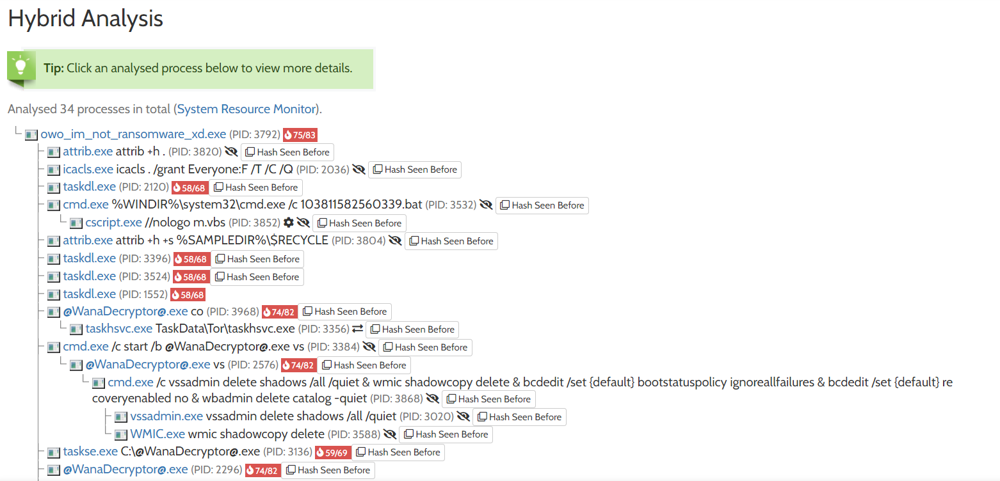

- Static Analysis provides us with useful information
- But we still need to move further to our analysis procedures
- Running it will show more properties and learn about the behavior of the malware more 

# Sandboxes
- Isolated environment for an actual target of a malware 
- It is run as a sample 
- Relies on Lab machines and then reverted to a clean slate afterwards 

# Construction of a Sandbox 
- Lab machine mimicking the actual environment
- Ability to take snapshots 
- Monitoring software (Procmon, Wireshark)
- Control through network through a dummy DNS server 
- Mechanism to move analysis logs and malware samples in and out 

# Open Source Sandboxes 
1. Cuckoo's sandbox 
	1. Most widely known
	2. Open source project
	3. Home Labs and SOC usage 
	4. Archived, update is pending, doesn't support python3.
2. CAPE sandbox 
	1. More advanced
	2. Supports debugging
	3. Supports memory dumping

# Online Sandboxes
1. Online Cuckoo Sandbox 
2. Any.run
3. Intezer
4. Hybrid analysis (https://hybrid-analysis.com/) -> can upload directly

# Hybrid Analysis Site
Provides: 
1. Information, hash, detection
	1. MITRE ATT&CK techniques found 
	2. Indicators 
	3. Context information
	4. Static analysis 
	5. Behavior of the sample 

	6. Parent-tree
	7. Network-analysis
	8. Extracted strings and files 
	9. Comments from community 