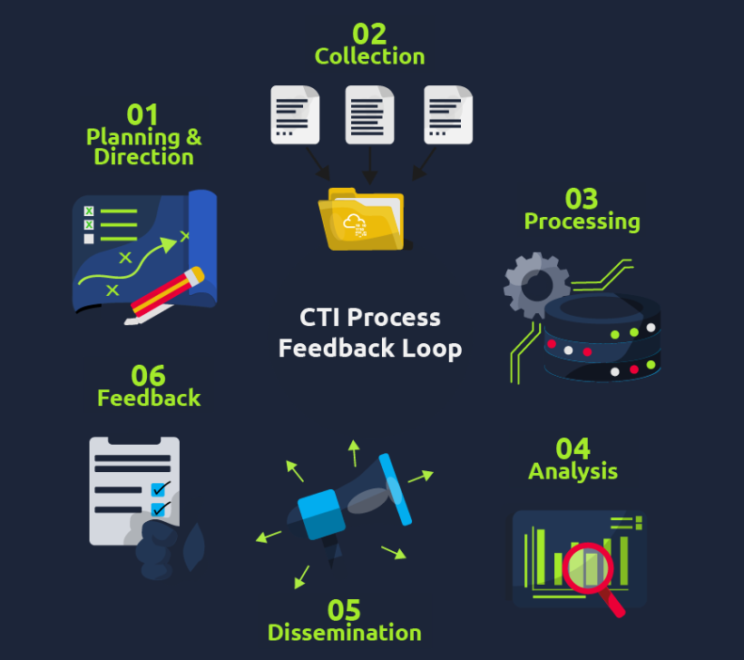

# TLP - Traffic Light Protocol
- Four color labelling scheme 

TLP: Clear 
```
No Restriction 
```

TLP: Green
```
Share with peer community but not publicly 
```

TLP: Amber 
```
Organization wide, external sharing to need-to-know clients only
```

TLP: Red
```
Named Recipients only 
```

Why do we need to label them? Isn't it better for everyone to know?
```
Since sharing IOCs aid with defenders but it can also:
	Alert the attacker
	Expose the victim 
	Reveal an intteligence source - how investigators obtained the information
	Break trust - The hospital shared it for your protection, not public disclosure
```

so why do IOCs or IOAs need to have these labels on them that is attached in first triage by a SOC?
```
So everyone knows how to handle it properly 
```

While investigating breaches, a Level 1 analyst ensures that an IOC's TLP label—if provided—travels with the indicator into any platform or triage note. Violating the label can breach contractual obligations and erode trust with intelligence partners.
```
Domain
1. Alert Appears - EDR alerts, but alert doesn't provide compromise with the given domain 

2. You find relevant threat intelligence through CTI platform 
Domain: suspicious.example
Assessment: Associated with a malware campaign
Sharing label: TLP:AMBER

3. You put that information in your investigation ticket 
```

# Intel Formats

One example would be STIX - Structured Threat Information Expression
- JSON schema 
- provide a way to describe indicators 
- relationships 
- context 
- machine-readable form