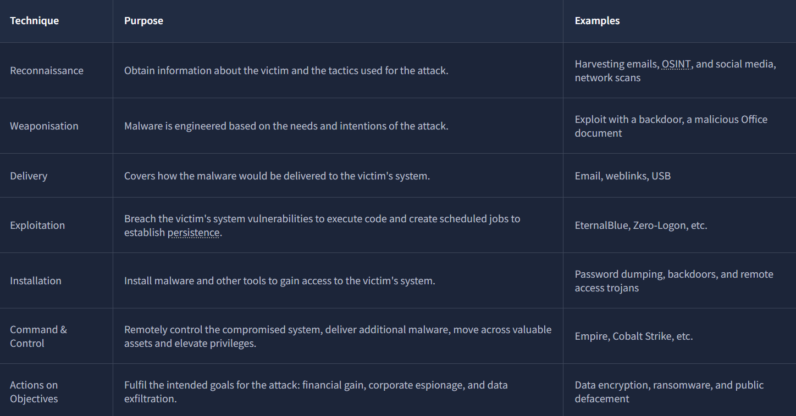

# 1 MITRE ATT&CK 
- Supplies information, description, labels 
- A common language for cybersecurity professionals
- Match the behavior and alert to a tactic/technique pair
- Write ID of the observed behavior 
- With this L2 immediately understands the context 


# 2 MITRE D3FEND
- how does defenders respond to a given 
- supplies the matching defensive technique to an ID from the ATT&CK tag
- provides practical control 


# 3 Cyber Kill Chain 





# 4 CVEs, CVSS, and NVD 

```
- CVE (Common Vulnerabilities and Exposures) — provides a catalogue number for discovered vulnerabilities, e.g., _CVE-2023-4863_.
- CVSS (Common Vulnerability Scoring System — a 0–10 severity scale with temporal and environmental modifiers for vulnerabilities.
- NVD (National Vulnerability Database — the canonical repository that links CVE numbers to CVSS scores, exploits, and affected products.
```

# 5 Sharing and Processing Intel

Standard for creating these information is 
```
STIX - JSON Schema
TAXII - The Trusted Automated eXchange of Indicator Information is a set of secure APIs used to exchange threat intelligence in near real-time for detection, prevention, and mitigation of threats.

Supports Collection and Channel
Collection
	which ensures threat intel is collected and hosted by a producer
Channel
	which publishes threat intel to users from a central server
```

