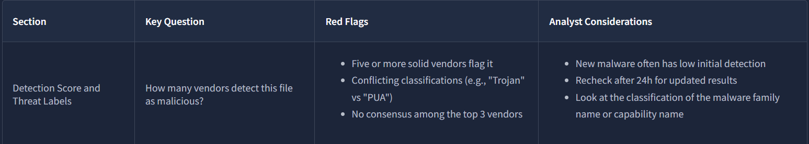
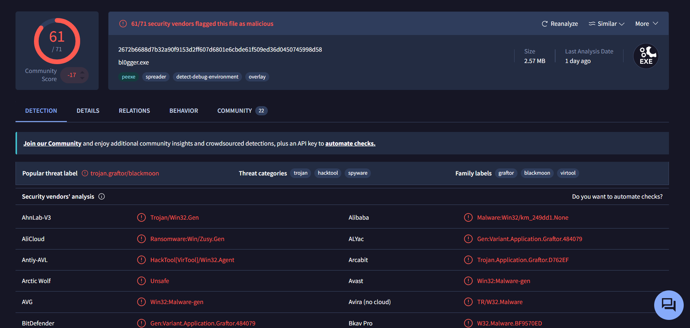
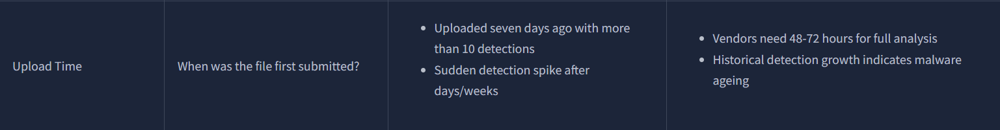
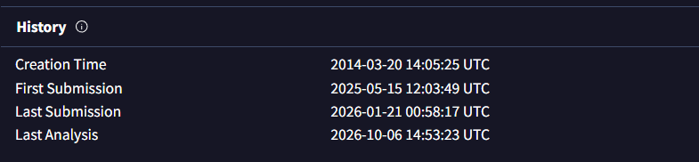
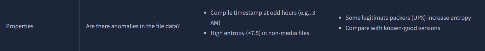
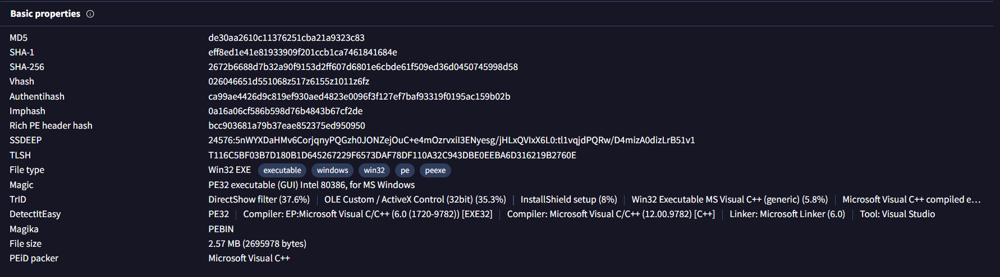
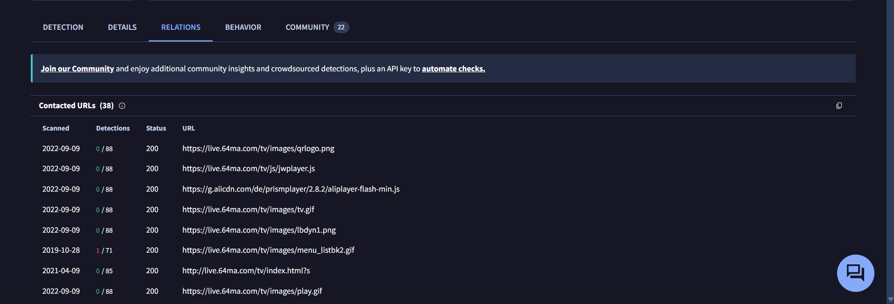
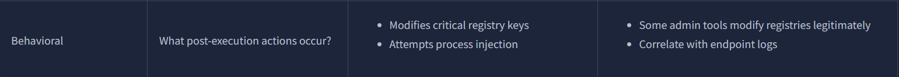
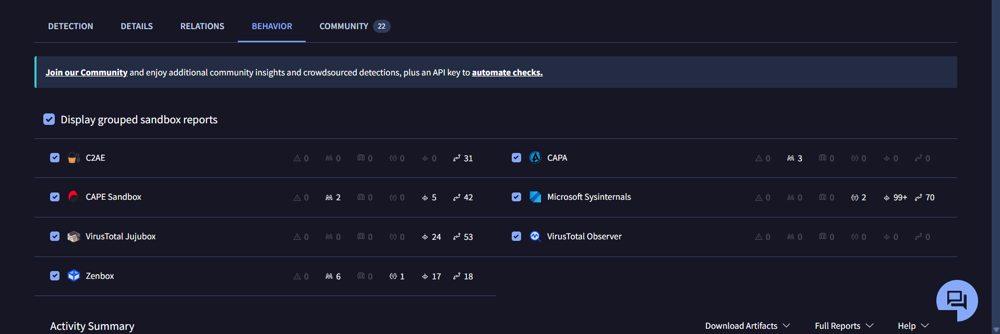

File names and properties are just for initial investigations. We can tie different names to a single binary 
- Hashing and checking its hash

Using certutil:
```
certutil -hashfile bl0gger.exe SHA256

Get-FileHash -Algorithm SHA256 bl0gger.exe | Out-File blogger.txt 

sha256sum bl0gger.exe > filehash
```

#  Pointers for Hashing 
- Store hashes in lowercase names 
- Hash what matters. If a zip file, both the zip and the extracted files
- Do not leave plain strings without the context of where and when you encountered them. Indicate more information about the hash, what the original file was, where you found it, when, etc. 
- Any byte difference will change the hash 


# Analysis with VirusTotal

Take note of
- Detection Score 
- Threat Labels and Categories 
- Detection Rules 
- Properties 
- Contained Domains and IPs
- Contained Files
1.








2.





Details -> History





3.

Details -> Signature Info if available 
4.








5.





6.








# Cross-Reference with MalwareBazaar
- MalwareBazaar is an all-in-one database for malware collection and analysis 

It has:
- Malware Sample Uploads 
	-  Security analysts can upload their malware samples for analysis and build the intelligence database. This can be done through the browser or an API.
- Malware hunting
	- Malware family tagging -  You will find files classified by their malware families. An example of this is a file with only 5/70 detections on VirusTotal but tagged as IcedID in MalwareBazaar; it should be treated as malicious. 
	- YARA rule integration - Many submissions will include rules that detect related samples. As an analyst, you should take note of these rules to be added to the EDR/SIEM for future hunting.
		- YARA is is a tool for identifying files or data that match patterns you define
	- Campaign Attribution - Tags such as #TA551, which belong to a threat actor group, help link observed incidents to known adversaries. This can help identify coordinated attacks against an environment.
	- Sample Availability - Malware samples are available for download and analysis
