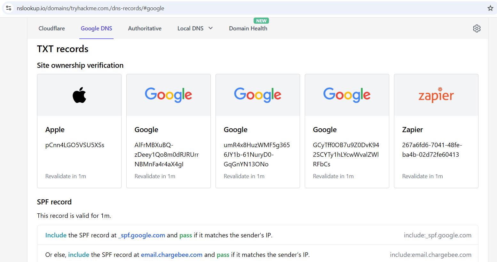
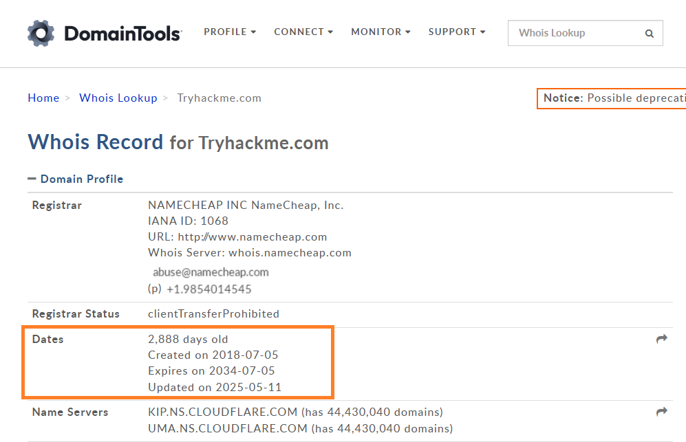

# Resolving DNS 

- User clicks a link
- Searches a link
- DNS works converts name -> mapped IP address 

# Domain Tools 
https://nslookup.io and https://dnschecker.org and https://whois.domaintools.com

What can we get from it? 

1. A/AAAA Records -> mapping of IPv4 or IPv6 addresses 
2. TXT Records -> Tell about the mail security SPF/DKIM/DMARC

# WHOIS being replaced by RDAP
Another tool for domain enrichment, it shows 
1. Registrar
2. Registration
3. Expiry Dates 
4. Domain's Age - usually, malicious domains live for only a few days 

