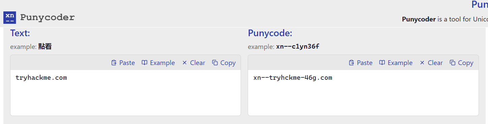

- CDN Abuse 
	- Multiple people 
	- Attackers route traffic through legitimate CDNs like cloudflare, akamai, or fastly to hid the origin server. 
	- If it points to a CDN range
	- The IP won't tell much. Since it can come from both malicious ang legitimate services

- Typosquatting 
	- registering sites that resemble popular websites like facebook, amazon, or google. 

- IDN Attacks 
	- Attackers substitute certain letters to Greek or Latin to make it look like the original name of the website. 
		- https://punycoder.com -> if it starts with xn--, the domain name contains a non-ASCII character
	

