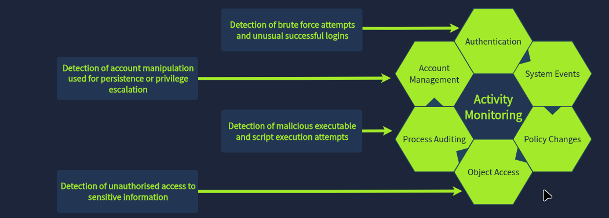
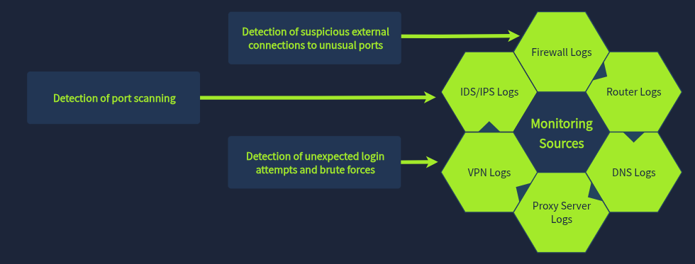
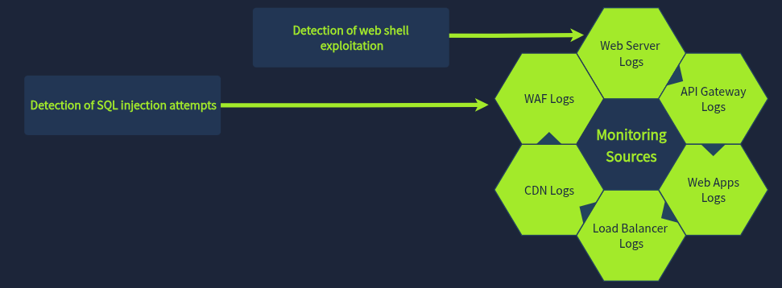

# Host-based Log Sources 
- Logs that come from individual devices within the organization 
	- Workstation
	- Servers 

# Network-based Log Sources
- Logs that come from networking devices
	- Firewall
	- Router
	- Switch
	- IDS
	- IPS
- Monitors traffic and connection across the network

# Web-based Log Sources 
- Web application logs
- Usually, web vulnerabilities are a way into the company 

