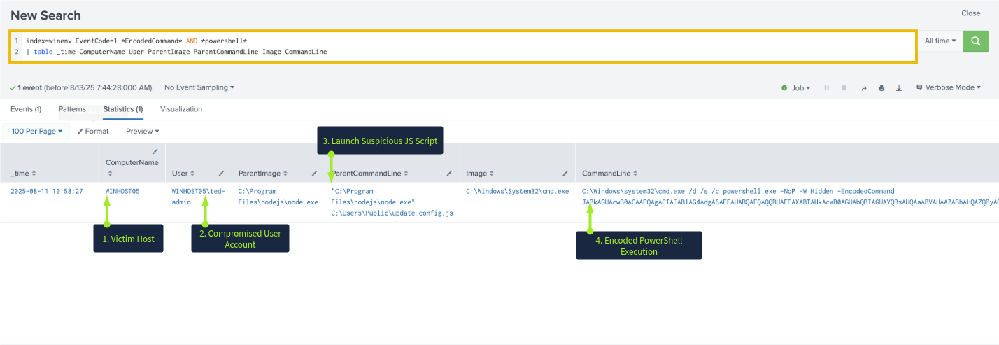
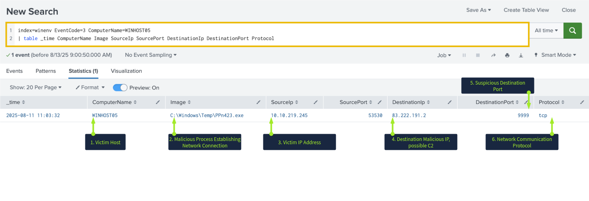
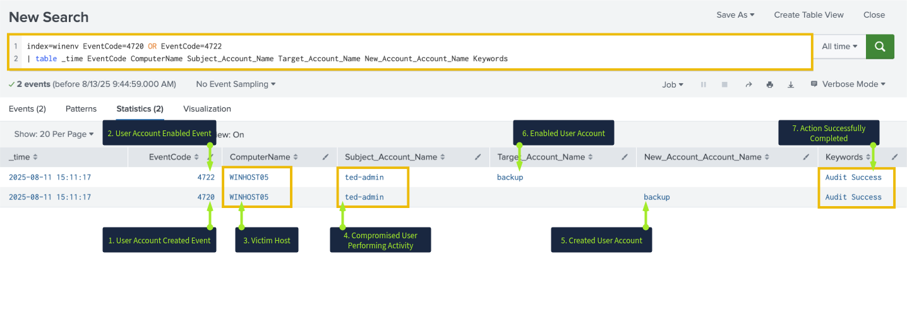
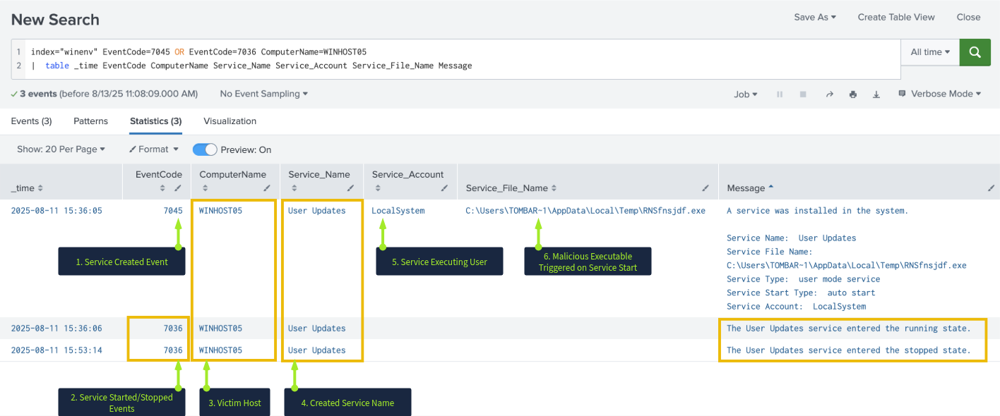

Two main sources:
```
Windows Event Logs - MOst familiart would be security/system/application
	In reality, contains over 200 idfferent log channels
	

Sysmon - additional or sometimes even the proimary log source for windows
		- provides higher visibility
Used for:
	Process execution
	Network Connections
	Possible process injection
	Registry changes 
	File creation
	
```


# Sysmon example 
- Alert about suspicious encoded powershell 
- You need to analyze the activity, how would you do it? 

This is in splunk: 
```
index=winenv EventCode=1 *powershell* AND *EncodedCommand*
| table_time ComputerName ParentUser ParentImage ParentCommandLine Image Command Line 
```

Example: 





# Suspicious Network Connection

After a few minutes we received a connection (Sysmon 3) from WINHOST05
```
index=winenv EventCode=3 ComputerName=WINHOST05  
|table _time ComputerName Image SourceIp SourcePort DestinationIp DestinationPort Protocol|
```





# Windows Security Logs 
- Most viewed and referenced log files. 
- Why? 
	- It shows authentication attempts 
	- Account creation/modification
	- Access to files 
	- Registry changes 
	- Process execution
	- System restarts 
	- Log clearing 
	- Changes to audit policies 
	- Changes to security policies 

# Example:
- From our previous example
	- WINHOST05 has been detected with a suspicious activity 
	- Specifically about another alert about account creation 
	- With this the attacker created a persistence and backdoor account for future access 
```
index=winenv EventCode=4720 OR EventCode=4722  
| table _time EventCode ComputerName Subject_Account_Name Target_Account_Name New_Account_Account_Name Keywords
```





# Windows System Logs 
- These logs are by the operating system and its core services. Events related to: 
	- services 
	- system-level activity 
	- potential errors 
- Usually used in looking for persistence and privilege escalation using services 
```
index=winenv EventCode=7045 OR EventCode=7036 ComputerName=WINHOST05  
| table _time EventCode ComputerName Service_Name Service_Account Service_File_Name Message|
```





From this we can see that:
1. User Update service was created 
2. File name is C:/...
3. It was also started 
4. And stopped 